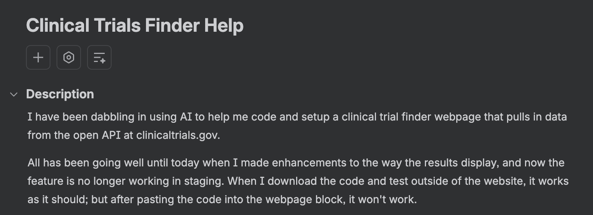
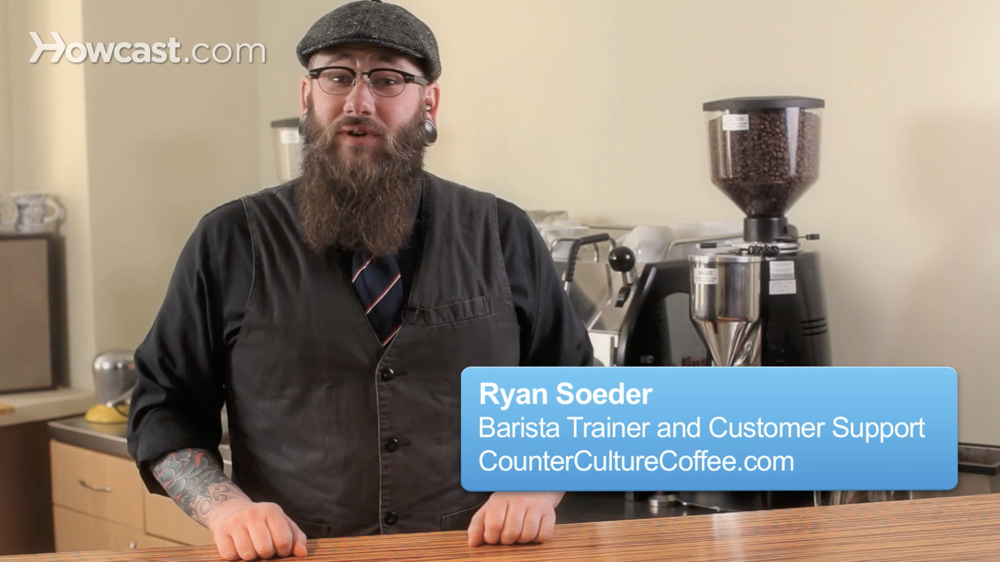
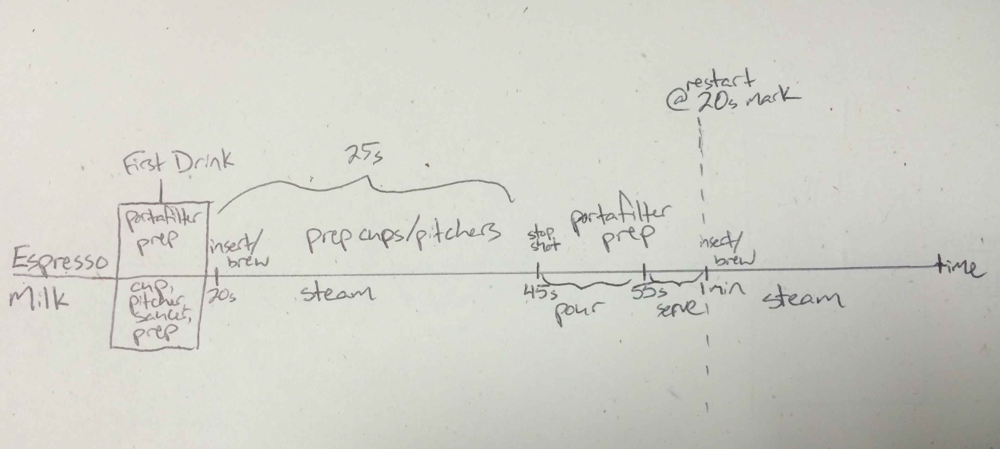
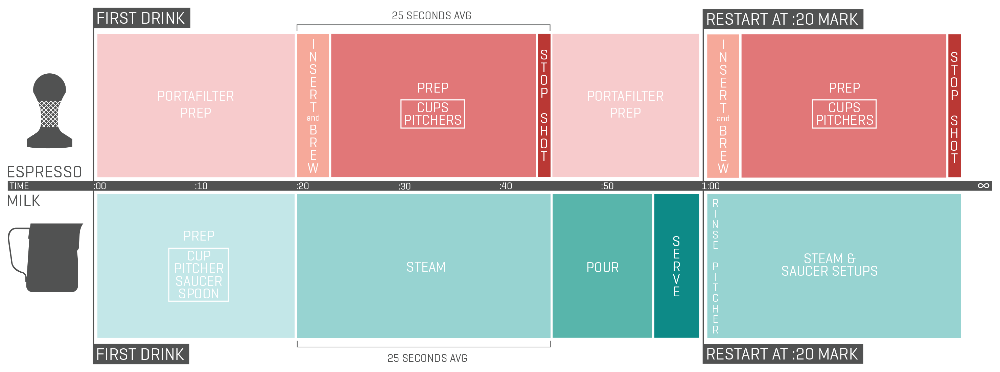
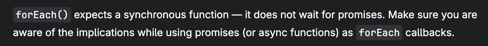

<NvimWindow :title="['Your App Isn\'t Slow.', 'It\'s Out of Order.']" />

---

<NvimWindow>
  
</NvimWindow>

---

```yaml
clicks: 3
```

<NvimWindow
  :shown="$clicks"
  :list="[
    'Breathing techniques for engineers',
    'Screaming into the void: when clients discover ChatGPT free tier',
    'Is profanity in the workplace ever justified? The answer might surprise you!',
  ]"
/>

---

<NvimWindow>
  
</NvimWindow>

---

<NvimWindow>
  
</NvimWindow>

---

<NvimWindow>
  
</NvimWindow>

<!--
Two baristas share one bar without waiting on each other.
-->

---

```yaml
clicks: 6
```

<EventLoop :steps="[
  { explain: [], hidden: ['micro'] },
  { explain: [], active: 'micro' },
  { explain: ['stack'], active: 'stack' },
  { explain: ['stack', 'loop'], active: 'loop' },
  { explain: ['stack', 'loop', 'micro'], active: 'micro' },
  { explain: ['stack', 'loop', 'micro', 'tasks'], active: 'tasks' },
  { explain: ['stack', 'loop', 'micro', 'tasks', 'apis'], active: 'apis' },
]" />

<!--
Click 1 adds the Microtask Queue: newer than the task queue, which goes back to the first browser JavaScript (setTimeout, DOM events).
CHECK: "added in 2020" isn't right. Microtasks date to MutationObserver (~2012) and ES2015 promises (~2014–15); the queueMicrotask() function shipped ~2018–19. Verify before saying a year.
Then click through what each box is for.
The event loop doesn't hand work out. Your code calls Web APIs; the browser queues tasks when timers fire or events arrive; promises queue microtasks. The loop moves queued work onto the stack when it's empty.
Each loop: one task, then every microtask (including ones queued along the way), then the browser gets a chance to paint. It isn't forced to.
The event loop and these queues come from the browser, not the JS engine.
-->

---

```yaml
clicks: 46
```

<div style="--slidev-code-font-size: 18px; --slidev-code-line-height: 22px">
<CodeTicks :shown="$clicks" :ticks="['tasks', 'stack', 'stack', 'tasks', 'micro', 'micro', null]">

```js {all|all|all|all|all|all|all|1|1|1|1|1|2|2|3|4|5|6|4|none|none|5|5|none|none|none|none|4|4|none|none|none|6|6|6|6|6|6|6|6|none|none|none|none|1|2|2}
button.addEventListener('click', search);
function search() {
	showSpinner();
	setTimeout(logSearch, 0);
	queueMicrotask(saveQuery);
	fetch('/trials').then(render).finally(hideSpinner);
}
```

</CodeTicks>
</div>

<EventLoop class="mt-3" :height="300" :steps="[
  { explain: ['stack', 'loop', 'micro', 'tasks', 'apis'] },
  { explain: ['stack', 'loop', 'micro', 'tasks', 'apis'] },
  { explain: ['stack', 'loop', 'micro', 'tasks', 'apis'] },
  { explain: ['stack', 'loop', 'micro', 'tasks', 'apis'] },
  { explain: ['stack', 'loop', 'micro', 'tasks', 'apis'] },
  { explain: ['stack', 'loop', 'micro', 'tasks', 'apis'] },
  { explain: ['stack', 'loop', 'micro', 'tasks', 'apis'] },
  { stack: ['addEventListener()'], look: 'stack', active: 'stack', caption: 'addEventListener runs' },
  { apis: [{ id: 'listener', label: 'click → search', at: 'addEventListener' }], look: 'stack', active: 'apis', caption: 'the browser holds the listener' },
  { apis: [{ id: 'listener', label: 'click → search', at: 'addEventListener' }], look: 'micro', active: 'micro', caption: 'any microtasks? none' },
  { apis: [{ id: 'listener', label: 'click → search', at: 'addEventListener' }], look: 'tasks', active: 'tasks', caption: 'no tasks → wait' },
  { apis: [{ id: 'listener', label: 'click → search', at: 'addEventListener' }], tasks: [{ id: 'click', label: 'search' }], look: 'tasks', active: 'tasks', caption: 'click → task queued' },
  { stack: [{ id: 'click', label: 'search()' }], apis: [{ id: 'listener', label: 'click → search', at: 'addEventListener' }], look: 'tasks', active: 'stack', caption: 'the task runs search()' },
  { stack: [{ id: 'click', label: 'search()' }], apis: [{ id: 'listener', label: 'click → search', at: 'addEventListener' }], look: 'stack', active: 'stack', caption: 'back to the stack' },
  { stack: [{ id: 'click', label: 'search()' }, 'showSpinner()'], apis: [{ id: 'listener', label: 'click → search', at: 'addEventListener' }], look: 'stack', active: 'stack', caption: 'runs right away' },
  { stack: [{ id: 'click', label: 'search()' }, 'setTimeout()'], apis: [{ id: 'listener', label: 'click → search', at: 'addEventListener' }, { id: 'log', label: 'logSearch', at: 'setTimeout' }], look: 'stack', active: ['stack', 'apis'], caption: 'timer goes to the browser' },
  { stack: [{ id: 'click', label: 'search()' }, 'queueMicrotask()'], apis: [{ id: 'listener', label: 'click → search', at: 'addEventListener' }, { id: 'log', label: 'logSearch', at: 'setTimeout' }], microtasks: [{ id: 'save', label: 'saveQuery' }], look: 'stack', active: ['stack', 'micro'], caption: 'straight to the microtask queue' },
  { stack: [{ id: 'click', label: 'search()' }, 'fetch()'], apis: [{ id: 'listener', label: 'click → search', at: 'addEventListener' }, { id: 'log', label: 'logSearch', at: 'setTimeout' }, { id: 'req', label: 'GET /trials', at: 'fetch' }], microtasks: [{ id: 'save', label: 'saveQuery' }], look: 'stack', active: ['stack', 'apis'], caption: 'request goes to the browser' },
  { stack: [{ id: 'click', label: 'search()' }], apis: [{ id: 'listener', label: 'click → search', at: 'addEventListener' }, { id: 'req', label: 'GET /trials', at: 'fetch' }], tasks: [{ id: 'log', label: 'logSearch' }], microtasks: [{ id: 'save', label: 'saveQuery' }], look: 'stack', active: 'tasks', caption: 'timer done → task queued' },
  { apis: [{ id: 'listener', label: 'click → search', at: 'addEventListener' }, { id: 'req', label: 'GET /trials', at: 'fetch' }], tasks: [{ id: 'log', label: 'logSearch' }], microtasks: [{ id: 'save', label: 'saveQuery' }], look: 'stack', active: 'stack', caption: 'search() returns → stack empty' },
  { apis: [{ id: 'listener', label: 'click → search', at: 'addEventListener' }, { id: 'req', label: 'GET /trials', at: 'fetch' }], tasks: [{ id: 'log', label: 'logSearch' }], microtasks: [{ id: 'save', label: 'saveQuery' }], look: 'micro', active: 'micro', caption: 'microtasks first' },
  { stack: [{ id: 'save', label: 'saveQuery' }], apis: [{ id: 'listener', label: 'click → search', at: 'addEventListener' }, { id: 'req', label: 'GET /trials', at: 'fetch' }], tasks: [{ id: 'log', label: 'logSearch' }], look: 'micro', active: 'stack', caption: 'saveQuery runs' },
  { stack: [{ id: 'save', label: 'saveQuery' }], apis: [{ id: 'listener', label: 'click → search', at: 'addEventListener' }, { id: 'req', label: 'GET /trials', at: 'fetch' }], tasks: [{ id: 'log', label: 'logSearch' }], look: 'stack', active: 'stack', caption: 'back to the stack' },
  { apis: [{ id: 'listener', label: 'click → search', at: 'addEventListener' }, { id: 'req', label: 'GET /trials', at: 'fetch' }], tasks: [{ id: 'log', label: 'logSearch' }], look: 'stack', active: 'stack', caption: 'saveQuery done' },
  { apis: [{ id: 'listener', label: 'click → search', at: 'addEventListener' }, { id: 'req', label: 'GET /trials', at: 'fetch' }], tasks: [{ id: 'log', label: 'logSearch' }], look: 'micro', active: 'micro', caption: 'more microtasks? none' },
  { apis: [{ id: 'listener', label: 'click → search', at: 'addEventListener' }, { id: 'req', label: 'GET /trials', at: 'fetch' }], tasks: [{ id: 'log', label: 'logSearch' }], look: 'micro', active: 'loop', render: true },
  { apis: [{ id: 'listener', label: 'click → search', at: 'addEventListener' }, { id: 'req', label: 'GET /trials', at: 'fetch' }], tasks: [{ id: 'log', label: 'logSearch' }], look: 'tasks', active: 'tasks', caption: 'then the next task' },
  { stack: [{ id: 'log', label: 'logSearch' }], apis: [{ id: 'listener', label: 'click → search', at: 'addEventListener' }, { id: 'req', label: 'GET /trials', at: 'fetch' }], look: 'tasks', active: 'stack', caption: 'logSearch runs' },
  { stack: [{ id: 'log', label: 'logSearch' }], apis: [{ id: 'listener', label: 'click → search', at: 'addEventListener' }, { id: 'req', label: 'GET /trials', at: 'fetch' }], look: 'stack', active: 'stack', caption: 'back to the stack' },
  { apis: [{ id: 'listener', label: 'click → search', at: 'addEventListener' }, { id: 'req', label: 'GET /trials', at: 'fetch' }], look: 'stack', active: 'stack', caption: 'logSearch done' },
  { apis: [{ id: 'listener', label: 'click → search', at: 'addEventListener' }, { id: 'req', label: 'GET /trials', at: 'fetch' }], look: 'micro', active: 'micro', caption: 'any microtasks? none' },
  { apis: [{ id: 'listener', label: 'click → search', at: 'addEventListener' }, { id: 'req', label: 'GET /trials', at: 'fetch' }], look: 'tasks', active: 'tasks', caption: 'no tasks → wait' },
  { apis: [{ id: 'listener', label: 'click → search', at: 'addEventListener' }], microtasks: [{ id: 'req', label: 'render' }], look: 'tasks', active: 'micro', caption: 'response → promise resolves → microtask' },
  { apis: [{ id: 'listener', label: 'click → search', at: 'addEventListener' }], microtasks: [{ id: 'req', label: 'render' }], look: 'micro', active: 'micro', caption: 'microtasks first' },
  { stack: [{ id: 'req', label: 'render' }], apis: [{ id: 'listener', label: 'click → search', at: 'addEventListener' }], look: 'micro', active: 'stack', caption: 'render runs' },
  { stack: [{ id: 'req', label: 'render' }], apis: [{ id: 'listener', label: 'click → search', at: 'addEventListener' }], look: 'stack', active: 'stack', caption: 'back to the stack' },
  { apis: [{ id: 'listener', label: 'click → search', at: 'addEventListener' }], microtasks: [{ id: 'hide', label: 'hideSpinner' }], look: 'stack', active: 'micro', caption: 'render done → finally queued' },
  { apis: [{ id: 'listener', label: 'click → search', at: 'addEventListener' }], microtasks: [{ id: 'hide', label: 'hideSpinner' }], look: 'micro', active: 'micro', caption: 'more microtasks? one' },
  { stack: [{ id: 'hide', label: 'hideSpinner' }], apis: [{ id: 'listener', label: 'click → search', at: 'addEventListener' }], look: 'micro', active: 'stack', caption: 'still before any paint' },
  { stack: [{ id: 'hide', label: 'hideSpinner' }], apis: [{ id: 'listener', label: 'click → search', at: 'addEventListener' }], look: 'stack', active: 'stack', caption: 'back to the stack' },
  { apis: [{ id: 'listener', label: 'click → search', at: 'addEventListener' }], look: 'stack', active: 'stack', caption: 'hideSpinner done' },
  { apis: [{ id: 'listener', label: 'click → search', at: 'addEventListener' }], look: 'micro', active: 'micro', caption: 'more microtasks? none' },
  { apis: [{ id: 'listener', label: 'click → search', at: 'addEventListener' }], look: 'micro', active: 'loop', render: true },
  { apis: [{ id: 'listener', label: 'click → search', at: 'addEventListener' }], look: 'tasks', active: 'tasks', caption: 'no tasks → wait' },
  { apis: [{ id: 'listener', label: 'click → search', at: 'addEventListener' }], tasks: [{ id: 'click2', label: 'search' }], look: 'tasks', active: ['apis', 'tasks'], caption: 'another click → another task' },
  { stack: [{ id: 'click2', label: 'search()' }], apis: [{ id: 'listener', label: 'click → search', at: 'addEventListener' }], look: 'tasks', active: 'stack', caption: 'search() runs again' },
  { stack: [{ id: 'click2', label: 'search()' }], apis: [{ id: 'listener', label: 'click → search', at: 'addEventListener' }], look: 'stack', active: 'stack', caption: 'back to the stack' },
]" />

<!--
Opens with the code fully readable and the box descriptions from the previous slide still up: walk through the code first.
Clicks 1–6 tick each line in the color of where its work goes: light teal = task queue (click events, setTimeout), red = runs on the call stack, dark teal = microtask queue (queueMicrotask, .then/.finally). fetch's request itself goes through Web APIs; its callbacks are microtasks.
Then the animation: addEventListener runs on the call stack first, and only then does the browser hold the listener (Web APIs).
Dead simple, and every queue gets used, twice.
The listener lives in the browser (Web APIs). A click doesn't call search() directly: the browser queues a task, and the event loop runs it when the stack is empty. User events are tasks.
showSpinner() runs right away. setTimeout → browser → task queue. queueMicrotask → straight to the microtask queue. fetch → browser; its .then callback becomes a microtask when the response arrives.
saveQuery runs before logSearch even though the timer was set first: microtasks first, then the next task.
First render opportunity (after the click task and its microtasks): that's when the spinner can actually show up. The last one is when the results can.
.finally(hideSpinner): queued only when render finishes, and it still runs before the render opportunity. Microtasks queued while emptying the queue run in the same pass; chaining them never lets the browser paint in between.
"Render opportunity": the browser may paint here. It isn't forced to.
Eyes get their own clicks, and they check what the real loop checks: after every task (and after each microtask) the loop looks at the microtask queue, even when it's empty; with no task waiting it sleeps until one arrives. Eyes on the stack just mean "waiting for this code to finish": the loop doesn't inspect the stack, it can't do anything until the running code returns.
Last clicks: a second click, and its search() lands on the stack (eyes back on the stack); no need to replay the rest. The listener is still registered, so the browser queues another search task; addEventListener keeps producing tasks until removeEventListener (or { once: true }). Compare setTimeout and fetch: one callback each, then they're gone from Web APIs.
If asked: for real analytics, navigator.sendBeacon() or requestIdleCallback() fit better than setTimeout. Here it's just a simple way to queue a task.
CHECK: the browser resolves the fetch promise from a networking task of its own; no JS of ours runs in it, so it's shown as going straight from Web APIs to the microtask queue.
-->

---

<NvimWindow>
<div style="--slidev-code-font-size: 18px; --slidev-code-line-height: 28px">

```js
async function enrichSelectedTrials() {
  const selectedTrials = allTrials.filter((trial) => selectedIds.has(trial.id));
  performance.mark('enrich:start');
  $('sections').innerHTML = '';

  showSpinner();
  apis.forEach(async (api) => {
    const details = await api.fetchDetails(selectedTrials);
    renderDetailsSection(api.name, details);
  });
  hideSpinner();

  performance.measure('enrich', 'enrich:start');
}
```

</div>
</NvimWindow>

<!--
From 00-baseline, app.js: the whole enrichSelectedTrials() function. Cut from the app: the 🐌 JANK / END JANK marker comments, and the trailing comment on hideSpinner(), "runs immediately — forEach didn't wait", so the room can guess first.
Why forEach can't handle promises: forEach calls the callback and throws away whatever it returns. An async function returns a promise, so forEach gets two promises (one per API), ignores both, and returns undefined right away.
await only pauses the async callback, not forEach and not enrichSelectedTrials(). Each callback runs up to its first await (fetchDetails starts the request), then hands back a promise and forEach moves on.
So hideSpinner() runs in the same task, before either response arrives. The spinner never gets painted; there's no render opportunity between showSpinner() and hideSpinner().
performance.measure() runs right away too, so the 'enrich' measurement covers almost nothing: it ends before any details arrive.
Each renderDetailsSection() runs later in its own microtask when its fetch resolves: sections land one by one, in whichever order the responses come back.
Nothing catches a rejection either: if a fetch fails, the rejected promise is unhandled.
Fix in Segment 1 (01-promise-all): apis.map(...) to get the promises, then await Promise.all(...) before hideSpinner(). for...of with await also waits, but one request at a time.
-->

---

<NvimWindow
  :title="['forEach()']"
  :list="[
    'Standardized in ES5 (2009). Promises arrived in ES2015.',
    'Expects a synchronous function',
    'Discards the callback\'s return value',
    'Always returns undefined',
  ]"
/>

<!--
All from MDN's Array.prototype.forEach page: developer.mozilla.org/en-US/docs/Web/JavaScript/Reference/Global_Objects/Array/forEach
MDN, verbatim: "forEach() expects a synchronous function — it does not wait for promises." / callbackFn: "Its return value is discarded." / "Unlike map(), forEach() always returns undefined and is not chainable." / "To run a series of asynchronous operations sequentially or concurrently, see promise composition."
MDN's own example: summing ratings with an async callback, then console.log(sum) prints 0, not 14. Same bug as hideSpinner(): the code after forEach runs before any await finishes.
Dates: forEach was standardized in ES5 (December 2009); Mozilla shipped it earlier, in JavaScript 1.6 (Firefox 1.5, 2005). Promises were standardized in ES2015 (June 2015), and async/await in ES2017. forEach was designed years before there was a promise to wait for.
Promise composition = for...of with await (in order) or Promise.all with map (all at once). Promise.all is the Segment 1 fix.
Also on MDN, if asked: "There is no way to stop or break a forEach() loop other than by throwing an exception." And throwing inside an async callback doesn't even do that: it just rejects that callback's promise.
-->

---

<NvimWindow>
  
</NvimWindow>

<!--
Straight from MDN's Array.prototype.forEach page: developer.mozilla.org/en-US/docs/Web/JavaScript/Reference/Global_Objects/Array/forEach
-->

---

```yaml
clicks: 37
```

<div style="--slidev-code-font-size: 18px; --slidev-code-line-height: 22px">

```js {all|all|none|none|none|1|2|3|3|3|3|5|6|6|none|none|none|none|none|none|3|3|4|4|none|none|none|none|none|none|3|3|4|4|none|none|none|none}
showSpinner();
apis.forEach(async (api) => {
  const details = await api.fetchDetails(selectedTrials);
  renderDetailsSection(api.name, details);
});
hideSpinner();
```

</div>

<EventLoop class="mt-3" :height="345" :steps="[
  { explain: ['stack', 'loop', 'micro', 'tasks', 'apis'] },
  { apis: [{ id: 'listener', label: 'click → enrich', at: 'addEventListener' }], look: 'tasks', active: 'tasks', caption: 'waiting for a click' },
  { apis: [{ id: 'listener', label: 'click → enrich', at: 'addEventListener' }], tasks: [{ id: 'click', label: 'enrichSelectedTrials' }], look: 'tasks', active: 'tasks', caption: 'click → task queued' },
  { stack: [{ id: 'click', label: 'enrichSelectedTrials()' }], apis: [{ id: 'listener', label: 'click → enrich', at: 'addEventListener' }], look: 'tasks', active: 'stack', caption: 'the task runs' },
  { stack: [{ id: 'click', label: 'enrichSelectedTrials()' }], apis: [{ id: 'listener', label: 'click → enrich', at: 'addEventListener' }], look: 'stack', active: 'stack', caption: 'back to the stack' },
  { stack: [{ id: 'click', label: 'enrichSelectedTrials()' }, 'showSpinner()'], apis: [{ id: 'listener', label: 'click → enrich', at: 'addEventListener' }], look: 'stack', active: 'stack', caption: 'spinner on (not painted yet)' },
  { stack: [{ id: 'click', label: 'enrichSelectedTrials()' }, { id: 'forEach', label: 'forEach()' }], apis: [{ id: 'listener', label: 'click → enrich', at: 'addEventListener' }], look: 'stack', active: 'stack', caption: 'forEach calls the callback' },
  { stack: [{ id: 'click', label: 'enrichSelectedTrials()' }, { id: 'forEach', label: 'forEach()' }, { id: 'cb-fda', label: 'Drug info callback' }], apis: [{ id: 'listener', label: 'click → enrich', at: 'addEventListener' }, { id: 'fda', label: 'GET openFDA', at: 'fetch' }], look: 'stack', active: ['stack', 'apis'], caption: 'request goes to the browser' },
  { stack: [{ id: 'click', label: 'enrichSelectedTrials()' }, { id: 'forEach', label: 'forEach()' }], apis: [{ id: 'listener', label: 'click → enrich', at: 'addEventListener' }, { id: 'fda', label: 'GET openFDA', at: 'fetch' }], look: 'stack', active: 'stack', caption: 'await pauses it; forEach drops the promise' },
  { stack: [{ id: 'click', label: 'enrichSelectedTrials()' }, { id: 'forEach', label: 'forEach()' }, { id: 'cb-pub', label: 'Publications callback' }], apis: [{ id: 'listener', label: 'click → enrich', at: 'addEventListener' }, { id: 'fda', label: 'GET openFDA', at: 'fetch' }, { id: 'pub', label: 'GET PubMed', at: 'fetch' }], look: 'stack', active: ['stack', 'apis'], caption: 'second callback, second request' },
  { stack: [{ id: 'click', label: 'enrichSelectedTrials()' }, { id: 'forEach', label: 'forEach()' }], apis: [{ id: 'listener', label: 'click → enrich', at: 'addEventListener' }, { id: 'fda', label: 'GET openFDA', at: 'fetch' }, { id: 'pub', label: 'GET PubMed', at: 'fetch' }], look: 'stack', active: 'stack', caption: 'paused too; promise dropped' },
  { stack: [{ id: 'click', label: 'enrichSelectedTrials()' }], apis: [{ id: 'listener', label: 'click → enrich', at: 'addEventListener' }, { id: 'fda', label: 'GET openFDA', at: 'fetch' }, { id: 'pub', label: 'GET PubMed', at: 'fetch' }], look: 'stack', active: 'stack', caption: 'forEach returns undefined' },
  { stack: [{ id: 'click', label: 'enrichSelectedTrials()' }, 'hideSpinner()'], apis: [{ id: 'listener', label: 'click → enrich', at: 'addEventListener' }, { id: 'fda', label: 'GET openFDA', at: 'fetch' }, { id: 'pub', label: 'GET PubMed', at: 'fetch' }], look: 'stack', active: 'stack', caption: 'spinner off, same task' },
  { stack: [{ id: 'click', label: 'enrichSelectedTrials()' }], apis: [{ id: 'listener', label: 'click → enrich', at: 'addEventListener' }, { id: 'fda', label: 'GET openFDA', at: 'fetch' }, { id: 'pub', label: 'GET PubMed', at: 'fetch' }], look: 'stack', active: 'stack', caption: 'hideSpinner() returns' },
  { apis: [{ id: 'listener', label: 'click → enrich', at: 'addEventListener' }, { id: 'fda', label: 'GET openFDA', at: 'fetch' }, { id: 'pub', label: 'GET PubMed', at: 'fetch' }], look: 'stack', active: 'stack', caption: 'task done → stack empty' },
  { apis: [{ id: 'listener', label: 'click → enrich', at: 'addEventListener' }, { id: 'fda', label: 'GET openFDA', at: 'fetch' }, { id: 'pub', label: 'GET PubMed', at: 'fetch' }], look: 'micro', active: 'micro', caption: 'any microtasks? none' },
  { apis: [{ id: 'listener', label: 'click → enrich', at: 'addEventListener' }, { id: 'fda', label: 'GET openFDA', at: 'fetch' }, { id: 'pub', label: 'GET PubMed', at: 'fetch' }], look: 'micro', active: 'loop', render: true, caption: 'paint: no spinner, ever' },
  { apis: [{ id: 'listener', label: 'click → enrich', at: 'addEventListener' }, { id: 'fda', label: 'GET openFDA', at: 'fetch' }, { id: 'pub', label: 'GET PubMed', at: 'fetch' }], look: 'tasks', active: 'tasks', caption: 'no tasks → wait' },
  { apis: [{ id: 'listener', label: 'click → enrich', at: 'addEventListener' }, { id: 'fda', label: 'GET openFDA', at: 'fetch' }], microtasks: [{ id: 'cb-pub', label: 'Publications callback' }], look: 'tasks', active: ['apis', 'micro'], caption: 'PubMed responds → microtask' },
  { apis: [{ id: 'listener', label: 'click → enrich', at: 'addEventListener' }, { id: 'fda', label: 'GET openFDA', at: 'fetch' }], microtasks: [{ id: 'cb-pub', label: 'Publications callback' }], look: 'micro', active: 'micro', caption: 'microtasks first' },
  { stack: [{ id: 'cb-pub', label: 'Publications callback' }], apis: [{ id: 'listener', label: 'click → enrich', at: 'addEventListener' }, { id: 'fda', label: 'GET openFDA', at: 'fetch' }], look: 'micro', active: 'stack', caption: 'the callback resumes after await' },
  { stack: [{ id: 'cb-pub', label: 'Publications callback' }], apis: [{ id: 'listener', label: 'click → enrich', at: 'addEventListener' }, { id: 'fda', label: 'GET openFDA', at: 'fetch' }], look: 'stack', active: 'stack', caption: 'back to the stack' },
  { stack: [{ id: 'cb-pub', label: 'Publications callback' }, 'renderDetailsSection()'], apis: [{ id: 'listener', label: 'click → enrich', at: 'addEventListener' }, { id: 'fda', label: 'GET openFDA', at: 'fetch' }], look: 'stack', active: 'stack', caption: 'Publications section lands' },
  { stack: [{ id: 'cb-pub', label: 'Publications callback' }], apis: [{ id: 'listener', label: 'click → enrich', at: 'addEventListener' }, { id: 'fda', label: 'GET openFDA', at: 'fetch' }], look: 'stack', active: 'stack', caption: 'renderDetailsSection() returns' },
  { apis: [{ id: 'listener', label: 'click → enrich', at: 'addEventListener' }, { id: 'fda', label: 'GET openFDA', at: 'fetch' }], look: 'stack', active: 'stack', caption: 'callback done → stack empty' },
  { apis: [{ id: 'listener', label: 'click → enrich', at: 'addEventListener' }, { id: 'fda', label: 'GET openFDA', at: 'fetch' }], look: 'micro', active: 'micro', caption: 'more microtasks? none' },
  { apis: [{ id: 'listener', label: 'click → enrich', at: 'addEventListener' }, { id: 'fda', label: 'GET openFDA', at: 'fetch' }], look: 'micro', active: 'loop', render: true, caption: 'paint: one section' },
  { apis: [{ id: 'listener', label: 'click → enrich', at: 'addEventListener' }, { id: 'fda', label: 'GET openFDA', at: 'fetch' }], look: 'tasks', active: 'tasks', caption: 'no tasks → wait' },
  { apis: [{ id: 'listener', label: 'click → enrich', at: 'addEventListener' }], microtasks: [{ id: 'cb-fda', label: 'Drug info callback' }], look: 'tasks', active: ['apis', 'micro'], caption: 'openFDA responds → microtask' },
  { apis: [{ id: 'listener', label: 'click → enrich', at: 'addEventListener' }], microtasks: [{ id: 'cb-fda', label: 'Drug info callback' }], look: 'micro', active: 'micro', caption: 'microtasks first' },
  { stack: [{ id: 'cb-fda', label: 'Drug info callback' }], apis: [{ id: 'listener', label: 'click → enrich', at: 'addEventListener' }], look: 'micro', active: 'stack', caption: 'the callback resumes after await' },
  { stack: [{ id: 'cb-fda', label: 'Drug info callback' }], apis: [{ id: 'listener', label: 'click → enrich', at: 'addEventListener' }], look: 'stack', active: 'stack', caption: 'back to the stack' },
  { stack: [{ id: 'cb-fda', label: 'Drug info callback' }, 'renderDetailsSection()'], apis: [{ id: 'listener', label: 'click → enrich', at: 'addEventListener' }], look: 'stack', active: 'stack', caption: 'Drug info section lands' },
  { stack: [{ id: 'cb-fda', label: 'Drug info callback' }], apis: [{ id: 'listener', label: 'click → enrich', at: 'addEventListener' }], look: 'stack', active: 'stack', caption: 'renderDetailsSection() returns' },
  { apis: [{ id: 'listener', label: 'click → enrich', at: 'addEventListener' }], look: 'stack', active: 'stack', caption: 'callback done → stack empty' },
  { apis: [{ id: 'listener', label: 'click → enrich', at: 'addEventListener' }], look: 'micro', active: 'micro', caption: 'more microtasks? none' },
  { apis: [{ id: 'listener', label: 'click → enrich', at: 'addEventListener' }], look: 'micro', active: 'loop', render: true, caption: 'paint: second section' },
  { apis: [{ id: 'listener', label: 'click → enrich', at: 'addEventListener' }], look: 'tasks', active: 'tasks', caption: 'no tasks → wait' },
]" />

<!--
The forEach block from 00-baseline (enrichSelectedTrials in app.js) run through the event loop. Code lines light up with the step.
Opens paused: code fully lit, box descriptions up, nothing moving. Walk through where each line will go before the first click: showSpinner() and forEach() run on the stack, fetchDetails() sends requests to the browser (Web APIs), the code after each await comes back as a microtask, and the click itself is a task.
The listener was registered at page load: $('enrich-button').addEventListener('click', () => enrichSelectedTrials().catch(showEnrichError)).
forEach calls each callback synchronously. Each callback runs until its first await: fetchDetails() starts a request (the browser holds it), then await pauses the callback and hands forEach a promise. forEach throws it away and calls the next one.
Both requests are in flight, forEach returns undefined, and hideSpinner() runs, all in the same task as showSpinner(). The first render opportunity comes after the task, so the spinner is never painted.
Order matters here: Drug information is first in the array, but PubMed answers first (offline mode: 340ms vs 1,200ms for openFDA), so Publications lands first. Sections land in arrival order, each one painted on its own, while the spinner is long gone.
CHECK, simplified for the slide: the callback resumes after several promise hops, not one: request() → fetch() resolves, then res.json() reads the body (more browser work), then fetchDetails()'s promise resolves, then the await in the callback continues. In offline mode request() also waits on a setTimeout first (a task). Shown as one microtask per response.
CHECK, also skipped: enrichSelectedTrials() returns a promise that's already resolved, and .catch(showEnrichError) on it queues a do-nothing microtask before the first paint. It changes nothing on screen.
-->
