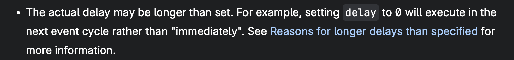
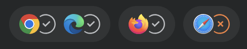

<NvimWindow :title="['Your App Isn\'t Slow.', 'It\'s Out of Order.']" />

---

<NvimWindow>
  
</NvimWindow>

---

```yaml
clicks: 3
```

<NvimWindow
  :shown="$clicks"
  :list="[
    'Breathing techniques for engineers',
    'Screaming into the void: when clients discover ChatGPT free tier',
    'Is profanity in the workplace ever justified? The answer might surprise you!',
  ]"
/>

---

<NvimWindow>
  
</NvimWindow>

---

<NvimWindow>
  
</NvimWindow>

---

<NvimWindow>
  
</NvimWindow>

<!--
Two baristas share one bar without waiting on each other.
-->

---

```yaml
clicks: 6
```

<EventLoop :steps="[
  { explain: [], hidden: ['micro'] },
  { explain: [], active: 'micro' },
  { explain: ['stack'], active: 'stack' },
  { explain: ['stack', 'loop'], active: 'loop' },
  { explain: ['stack', 'loop', 'micro'], active: 'micro' },
  { explain: ['stack', 'loop', 'micro', 'tasks'], active: 'tasks' },
  { explain: ['stack', 'loop', 'micro', 'tasks', 'apis'], active: 'apis' },
]" />

<!--
Click 1 adds the Microtask Queue: newer than the task queue, which goes back to the first browser JavaScript (setTimeout, DOM events).
CHECK: "added in 2020" isn't right. Microtasks date to MutationObserver (~2012) and ES2015 promises (~2014–15); the queueMicrotask() function shipped ~2018–19. Verify before saying a year.
Then click through what each box is for.
The event loop doesn't hand work out. Your code calls Web APIs; the browser queues tasks when timers fire or events arrive; promises queue microtasks. The loop moves queued work onto the stack when it's empty.
Each loop: one task, then every microtask (including ones queued along the way), then the browser gets a chance to paint. It isn't forced to.
The event loop and these queues come from the browser, not the JS engine.
-->

---

```yaml
clicks: 46
```

<div style="--slidev-code-font-size: 18px; --slidev-code-line-height: 22px">
<CodeTicks :shown="$clicks" :ticks="['tasks', 'stack', 'stack', 'tasks', 'micro', 'micro', null]">

```js {all|all|all|all|all|all|all|1|1|1|1|1|2|2|3|4|5|6|4|none|none|5|5|none|none|none|none|4|4|none|none|none|6|6|6|6|6|6|6|6|none|none|none|none|1|2|2}
button.addEventListener('click', search);
function search() {
	showSpinner();
	setTimeout(logSearch, 0);
	queueMicrotask(saveQuery);
	fetch('/trials').then(render).finally(hideSpinner);
}
```

</CodeTicks>
</div>

<EventLoop class="mt-3" :height="300" :steps="[
  { explain: ['stack', 'loop', 'micro', 'tasks', 'apis'] },
  { explain: ['stack', 'loop', 'micro', 'tasks', 'apis'] },
  { explain: ['stack', 'loop', 'micro', 'tasks', 'apis'] },
  { explain: ['stack', 'loop', 'micro', 'tasks', 'apis'] },
  { explain: ['stack', 'loop', 'micro', 'tasks', 'apis'] },
  { explain: ['stack', 'loop', 'micro', 'tasks', 'apis'] },
  { explain: ['stack', 'loop', 'micro', 'tasks', 'apis'] },
  { stack: ['addEventListener()'], look: 'stack', active: 'stack', caption: 'addEventListener runs' },
  { apis: [{ id: 'listener', label: 'click → search', at: 'addEventListener' }], look: 'stack', active: 'apis', caption: 'the browser holds the listener' },
  { apis: [{ id: 'listener', label: 'click → search', at: 'addEventListener' }], look: 'micro', active: 'micro', caption: 'any microtasks? none' },
  { apis: [{ id: 'listener', label: 'click → search', at: 'addEventListener' }], look: 'tasks', active: 'tasks', caption: 'no tasks → wait' },
  { apis: [{ id: 'listener', label: 'click → search', at: 'addEventListener' }], tasks: [{ id: 'click', label: 'search' }], look: 'tasks', active: 'tasks', caption: 'click → task queued' },
  { stack: [{ id: 'click', label: 'search()' }], apis: [{ id: 'listener', label: 'click → search', at: 'addEventListener' }], look: 'tasks', active: 'stack', caption: 'the task runs search()' },
  { stack: [{ id: 'click', label: 'search()' }], apis: [{ id: 'listener', label: 'click → search', at: 'addEventListener' }], look: 'stack', active: 'stack', caption: 'back to the stack' },
  { stack: [{ id: 'click', label: 'search()' }, 'showSpinner()'], apis: [{ id: 'listener', label: 'click → search', at: 'addEventListener' }], look: 'stack', active: 'stack', caption: 'runs right away' },
  { stack: [{ id: 'click', label: 'search()' }, 'setTimeout()'], apis: [{ id: 'listener', label: 'click → search', at: 'addEventListener' }, { id: 'log', label: 'logSearch', at: 'setTimeout' }], look: 'stack', active: ['stack', 'apis'], caption: 'timer goes to the browser' },
  { stack: [{ id: 'click', label: 'search()' }, 'queueMicrotask()'], apis: [{ id: 'listener', label: 'click → search', at: 'addEventListener' }, { id: 'log', label: 'logSearch', at: 'setTimeout' }], microtasks: [{ id: 'save', label: 'saveQuery' }], look: 'stack', active: ['stack', 'micro'], caption: 'straight to the microtask queue' },
  { stack: [{ id: 'click', label: 'search()' }, 'fetch()'], apis: [{ id: 'listener', label: 'click → search', at: 'addEventListener' }, { id: 'log', label: 'logSearch', at: 'setTimeout' }, { id: 'req', label: 'GET /trials', at: 'fetch' }], microtasks: [{ id: 'save', label: 'saveQuery' }], look: 'stack', active: ['stack', 'apis'], caption: 'request goes to the browser' },
  { stack: [{ id: 'click', label: 'search()' }], apis: [{ id: 'listener', label: 'click → search', at: 'addEventListener' }, { id: 'req', label: 'GET /trials', at: 'fetch' }], tasks: [{ id: 'log', label: 'logSearch' }], microtasks: [{ id: 'save', label: 'saveQuery' }], look: 'stack', active: 'tasks', caption: 'timer done → task queued' },
  { apis: [{ id: 'listener', label: 'click → search', at: 'addEventListener' }, { id: 'req', label: 'GET /trials', at: 'fetch' }], tasks: [{ id: 'log', label: 'logSearch' }], microtasks: [{ id: 'save', label: 'saveQuery' }], look: 'stack', active: 'stack', caption: 'search() returns → stack empty' },
  { apis: [{ id: 'listener', label: 'click → search', at: 'addEventListener' }, { id: 'req', label: 'GET /trials', at: 'fetch' }], tasks: [{ id: 'log', label: 'logSearch' }], microtasks: [{ id: 'save', label: 'saveQuery' }], look: 'micro', active: 'micro', caption: 'microtasks first' },
  { stack: [{ id: 'save', label: 'saveQuery' }], apis: [{ id: 'listener', label: 'click → search', at: 'addEventListener' }, { id: 'req', label: 'GET /trials', at: 'fetch' }], tasks: [{ id: 'log', label: 'logSearch' }], look: 'micro', active: 'stack', caption: 'saveQuery runs' },
  { stack: [{ id: 'save', label: 'saveQuery' }], apis: [{ id: 'listener', label: 'click → search', at: 'addEventListener' }, { id: 'req', label: 'GET /trials', at: 'fetch' }], tasks: [{ id: 'log', label: 'logSearch' }], look: 'stack', active: 'stack', caption: 'back to the stack' },
  { apis: [{ id: 'listener', label: 'click → search', at: 'addEventListener' }, { id: 'req', label: 'GET /trials', at: 'fetch' }], tasks: [{ id: 'log', label: 'logSearch' }], look: 'stack', active: 'stack', caption: 'saveQuery done' },
  { apis: [{ id: 'listener', label: 'click → search', at: 'addEventListener' }, { id: 'req', label: 'GET /trials', at: 'fetch' }], tasks: [{ id: 'log', label: 'logSearch' }], look: 'micro', active: 'micro', caption: 'more microtasks? none' },
  { apis: [{ id: 'listener', label: 'click → search', at: 'addEventListener' }, { id: 'req', label: 'GET /trials', at: 'fetch' }], tasks: [{ id: 'log', label: 'logSearch' }], look: 'micro', active: 'loop', render: true },
  { apis: [{ id: 'listener', label: 'click → search', at: 'addEventListener' }, { id: 'req', label: 'GET /trials', at: 'fetch' }], tasks: [{ id: 'log', label: 'logSearch' }], look: 'tasks', active: 'tasks', caption: 'then the next task' },
  { stack: [{ id: 'log', label: 'logSearch' }], apis: [{ id: 'listener', label: 'click → search', at: 'addEventListener' }, { id: 'req', label: 'GET /trials', at: 'fetch' }], look: 'tasks', active: 'stack', caption: 'logSearch runs' },
  { stack: [{ id: 'log', label: 'logSearch' }], apis: [{ id: 'listener', label: 'click → search', at: 'addEventListener' }, { id: 'req', label: 'GET /trials', at: 'fetch' }], look: 'stack', active: 'stack', caption: 'back to the stack' },
  { apis: [{ id: 'listener', label: 'click → search', at: 'addEventListener' }, { id: 'req', label: 'GET /trials', at: 'fetch' }], look: 'stack', active: 'stack', caption: 'logSearch done' },
  { apis: [{ id: 'listener', label: 'click → search', at: 'addEventListener' }, { id: 'req', label: 'GET /trials', at: 'fetch' }], look: 'micro', active: 'micro', caption: 'any microtasks? none' },
  { apis: [{ id: 'listener', label: 'click → search', at: 'addEventListener' }, { id: 'req', label: 'GET /trials', at: 'fetch' }], look: 'tasks', active: 'tasks', caption: 'no tasks → wait' },
  { apis: [{ id: 'listener', label: 'click → search', at: 'addEventListener' }], microtasks: [{ id: 'req', label: 'render' }], look: 'tasks', active: 'micro', caption: 'response → promise resolves → microtask' },
  { apis: [{ id: 'listener', label: 'click → search', at: 'addEventListener' }], microtasks: [{ id: 'req', label: 'render' }], look: 'micro', active: 'micro', caption: 'microtasks first' },
  { stack: [{ id: 'req', label: 'render' }], apis: [{ id: 'listener', label: 'click → search', at: 'addEventListener' }], look: 'micro', active: 'stack', caption: 'render runs' },
  { stack: [{ id: 'req', label: 'render' }], apis: [{ id: 'listener', label: 'click → search', at: 'addEventListener' }], look: 'stack', active: 'stack', caption: 'back to the stack' },
  { apis: [{ id: 'listener', label: 'click → search', at: 'addEventListener' }], microtasks: [{ id: 'hide', label: 'hideSpinner' }], look: 'stack', active: 'micro', caption: 'render done → finally queued' },
  { apis: [{ id: 'listener', label: 'click → search', at: 'addEventListener' }], microtasks: [{ id: 'hide', label: 'hideSpinner' }], look: 'micro', active: 'micro', caption: 'more microtasks? one' },
  { stack: [{ id: 'hide', label: 'hideSpinner' }], apis: [{ id: 'listener', label: 'click → search', at: 'addEventListener' }], look: 'micro', active: 'stack', caption: 'still before any paint' },
  { stack: [{ id: 'hide', label: 'hideSpinner' }], apis: [{ id: 'listener', label: 'click → search', at: 'addEventListener' }], look: 'stack', active: 'stack', caption: 'back to the stack' },
  { apis: [{ id: 'listener', label: 'click → search', at: 'addEventListener' }], look: 'stack', active: 'stack', caption: 'hideSpinner done' },
  { apis: [{ id: 'listener', label: 'click → search', at: 'addEventListener' }], look: 'micro', active: 'micro', caption: 'more microtasks? none' },
  { apis: [{ id: 'listener', label: 'click → search', at: 'addEventListener' }], look: 'micro', active: 'loop', render: true },
  { apis: [{ id: 'listener', label: 'click → search', at: 'addEventListener' }], look: 'tasks', active: 'tasks', caption: 'no tasks → wait' },
  { apis: [{ id: 'listener', label: 'click → search', at: 'addEventListener' }], tasks: [{ id: 'click2', label: 'search' }], look: 'tasks', active: ['apis', 'tasks'], caption: 'another click → another task' },
  { stack: [{ id: 'click2', label: 'search()' }], apis: [{ id: 'listener', label: 'click → search', at: 'addEventListener' }], look: 'tasks', active: 'stack', caption: 'search() runs again' },
  { stack: [{ id: 'click2', label: 'search()' }], apis: [{ id: 'listener', label: 'click → search', at: 'addEventListener' }], look: 'stack', active: 'stack', caption: 'back to the stack' },
]" />

<!--
Opens with the code fully readable and the box descriptions from the previous slide still up: walk through the code first.
Clicks 1–6 tick each line in the color of where its work goes: light teal = task queue (click events, setTimeout), red = runs on the call stack, dark teal = microtask queue (queueMicrotask, .then/.finally). fetch's request itself goes through Web APIs; its callbacks are microtasks.
Then the animation: addEventListener runs on the call stack first, and only then does the browser hold the listener (Web APIs).
Dead simple, and every queue gets used, twice.
The listener lives in the browser (Web APIs). A click doesn't call search() directly: the browser queues a task, and the event loop runs it when the stack is empty. User events are tasks.
showSpinner() runs right away. setTimeout → browser → task queue. queueMicrotask → straight to the microtask queue. fetch → browser; its .then callback becomes a microtask when the response arrives.
saveQuery runs before logSearch even though the timer was set first: microtasks first, then the next task.
First render opportunity (after the click task and its microtasks): that's when the spinner can actually show up. The last one is when the results can.
.finally(hideSpinner): queued only when render finishes, and it still runs before the render opportunity. Microtasks queued while emptying the queue run in the same pass; chaining them never lets the browser paint in between.
"Render opportunity": the browser may paint here. It isn't forced to.
Eyes get their own clicks, and they check what the real loop checks: after every task (and after each microtask) the loop looks at the microtask queue, even when it's empty; with no task waiting it sleeps until one arrives. Eyes on the stack just mean "waiting for this code to finish": the loop doesn't inspect the stack, it can't do anything until the running code returns.
Last clicks: a second click, and its search() lands on the stack (eyes back on the stack); no need to replay the rest. The listener is still registered, so the browser queues another search task; addEventListener keeps producing tasks until removeEventListener (or { once: true }). Compare setTimeout and fetch: one callback each, then they're gone from Web APIs.
If asked: for real analytics, navigator.sendBeacon() or requestIdleCallback() fit better than setTimeout. Here it's just a simple way to queue a task.
CHECK: the browser resolves the fetch promise from a networking task of its own; no JS of ours runs in it, so it's shown as going straight from Web APIs to the microtask queue.
-->

---

<NvimWindow>
<div style="--slidev-code-font-size: 18px; --slidev-code-line-height: 28px">

```js
async function enrichSelectedTrials() {
  const selectedTrials = allTrials.filter((trial) => selectedIds.has(trial.id));
  performance.mark('enrich:start');
  $('sections').innerHTML = '';

  showSpinner();
  apis.forEach(async (api) => {
    const details = await api.fetchDetails(selectedTrials);
    renderDetailsSection(api.name, details);
  });
  hideSpinner();

  performance.measure('enrich', 'enrich:start');
}
```

</div>
</NvimWindow>

<!--
From 00-baseline, app.js: the whole enrichSelectedTrials() function. Cut from the app: the 🐌 JANK / END JANK marker comments, and the trailing comment on hideSpinner(), "runs immediately — forEach didn't wait", so the room can guess first.
Why forEach can't handle promises: forEach calls the callback and throws away whatever it returns. An async function returns a promise, so forEach gets two promises (one per API), ignores both, and returns undefined right away.
await only pauses the async callback, not forEach and not enrichSelectedTrials(). Each callback runs up to its first await (fetchDetails starts the request), then hands back a promise and forEach moves on.
So hideSpinner() runs in the same task, before either response arrives. The spinner never gets painted; there's no render opportunity between showSpinner() and hideSpinner().
performance.measure() runs right away too, so the 'enrich' measurement covers almost nothing: it ends before any details arrive.
Each renderDetailsSection() runs later in its own microtask when its fetch resolves: sections land one by one, in whichever order the responses come back.
Nothing catches a rejection either: if a fetch fails, the rejected promise is unhandled.
Fix in Segment 1 (01-promise-all): apis.map(...) to get the promises, then await Promise.all(...) before hideSpinner(). for...of with await also waits, but one request at a time.
-->

---

<NvimWindow
  :title="['forEach()']"
  :list="[
    'Standardized in ES5 (2009). Promises arrived in ES2015.',
    'Expects a synchronous function',
    'Discards the callback\'s return value',
    'Always returns undefined',
  ]"
/>

<!--
All from MDN's Array.prototype.forEach page: developer.mozilla.org/en-US/docs/Web/JavaScript/Reference/Global_Objects/Array/forEach
MDN, verbatim: "forEach() expects a synchronous function — it does not wait for promises." / callbackFn: "Its return value is discarded." / "Unlike map(), forEach() always returns undefined and is not chainable." / "To run a series of asynchronous operations sequentially or concurrently, see promise composition."
MDN's own example: summing ratings with an async callback, then console.log(sum) prints 0, not 14. Same bug as hideSpinner(): the code after forEach runs before any await finishes.
Dates: forEach was standardized in ES5 (December 2009); Mozilla shipped it earlier, in JavaScript 1.6 (Firefox 1.5, 2005). Promises were standardized in ES2015 (June 2015), and async/await in ES2017. forEach was designed years before there was a promise to wait for.
Promise composition = for...of with await (in order) or Promise.all with map (all at once). Promise.all is the Segment 1 fix.
Also on MDN, if asked: "There is no way to stop or break a forEach() loop other than by throwing an exception." And throwing inside an async callback doesn't even do that: it just rejects that callback's promise.
-->

---

<NvimWindow>
  
</NvimWindow>

<!--
Straight from MDN's Array.prototype.forEach page: developer.mozilla.org/en-US/docs/Web/JavaScript/Reference/Global_Objects/Array/forEach
-->

---

```yaml
clicks: 37
```

<div style="--slidev-code-font-size: 18px; --slidev-code-line-height: 22px">

```js {all|all|none|none|none|1|2|3|3|3|3|5|6|6|none|none|none|none|none|none|3|3|4|4|none|none|none|none|none|none|3|3|4|4|none|none|none|none}
showSpinner();
apis.forEach(async (api) => {
  const details = await api.fetchDetails(selectedTrials);
  renderDetailsSection(api.name, details);
});
hideSpinner();
```

</div>

<EventLoop class="mt-3" :height="345" :steps="[
  { explain: ['apis'] },
  { apis: [{ id: 'listener', label: 'click → enrich', at: 'addEventListener' }], look: 'tasks', active: 'tasks', caption: 'waiting for a click' },
  { apis: [{ id: 'listener', label: 'click → enrich', at: 'addEventListener' }], tasks: [{ id: 'click', label: 'enrichSelectedTrials' }], look: 'tasks', active: 'tasks', caption: 'click → task queued' },
  { stack: [{ id: 'click', label: 'enrichSelectedTrials()' }], apis: [{ id: 'listener', label: 'click → enrich', at: 'addEventListener' }], look: 'tasks', active: 'stack', caption: 'the task runs' },
  { stack: [{ id: 'click', label: 'enrichSelectedTrials()' }], apis: [{ id: 'listener', label: 'click → enrich', at: 'addEventListener' }], look: 'stack', active: 'stack', caption: 'back to the stack' },
  { stack: [{ id: 'click', label: 'enrichSelectedTrials()' }, 'showSpinner()'], apis: [{ id: 'listener', label: 'click → enrich', at: 'addEventListener' }], look: 'stack', active: 'stack', caption: 'spinner on (not painted yet)' },
  { stack: [{ id: 'click', label: 'enrichSelectedTrials()' }, { id: 'forEach', label: 'forEach()' }], apis: [{ id: 'listener', label: 'click → enrich', at: 'addEventListener' }], look: 'stack', active: 'stack', caption: 'forEach calls the callback' },
  { stack: [{ id: 'click', label: 'enrichSelectedTrials()' }, { id: 'forEach', label: 'forEach()' }, { id: 'cb-fda', label: 'Drug info callback' }], apis: [{ id: 'listener', label: 'click → enrich', at: 'addEventListener' }, { id: 'fda', label: 'GET openFDA', at: 'fetch' }], look: 'stack', active: ['stack', 'apis'], caption: 'request goes to the browser' },
  { stack: [{ id: 'click', label: 'enrichSelectedTrials()' }, { id: 'forEach', label: 'forEach()' }], apis: [{ id: 'listener', label: 'click → enrich', at: 'addEventListener' }, { id: 'fda', label: 'GET openFDA', at: 'fetch' }], look: 'stack', active: 'stack', caption: 'await pauses it; forEach drops the promise' },
  { stack: [{ id: 'click', label: 'enrichSelectedTrials()' }, { id: 'forEach', label: 'forEach()' }, { id: 'cb-pub', label: 'Publications callback' }], apis: [{ id: 'listener', label: 'click → enrich', at: 'addEventListener' }, { id: 'fda', label: 'GET openFDA', at: 'fetch' }, { id: 'pub', label: 'GET PubMed', at: 'fetch' }], look: 'stack', active: ['stack', 'apis'], caption: 'second callback, second request' },
  { stack: [{ id: 'click', label: 'enrichSelectedTrials()' }, { id: 'forEach', label: 'forEach()' }], apis: [{ id: 'listener', label: 'click → enrich', at: 'addEventListener' }, { id: 'fda', label: 'GET openFDA', at: 'fetch' }, { id: 'pub', label: 'GET PubMed', at: 'fetch' }], look: 'stack', active: 'stack', caption: 'paused too; promise dropped' },
  { stack: [{ id: 'click', label: 'enrichSelectedTrials()' }], apis: [{ id: 'listener', label: 'click → enrich', at: 'addEventListener' }, { id: 'fda', label: 'GET openFDA', at: 'fetch' }, { id: 'pub', label: 'GET PubMed', at: 'fetch' }], look: 'stack', active: 'stack', caption: 'forEach returns undefined' },
  { stack: [{ id: 'click', label: 'enrichSelectedTrials()' }, 'hideSpinner()'], apis: [{ id: 'listener', label: 'click → enrich', at: 'addEventListener' }, { id: 'fda', label: 'GET openFDA', at: 'fetch' }, { id: 'pub', label: 'GET PubMed', at: 'fetch' }], look: 'stack', active: 'stack', caption: 'spinner off, same task' },
  { stack: [{ id: 'click', label: 'enrichSelectedTrials()' }], apis: [{ id: 'listener', label: 'click → enrich', at: 'addEventListener' }, { id: 'fda', label: 'GET openFDA', at: 'fetch' }, { id: 'pub', label: 'GET PubMed', at: 'fetch' }], look: 'stack', active: 'stack', caption: 'hideSpinner() returns' },
  { apis: [{ id: 'listener', label: 'click → enrich', at: 'addEventListener' }, { id: 'fda', label: 'GET openFDA', at: 'fetch' }, { id: 'pub', label: 'GET PubMed', at: 'fetch' }], look: 'stack', active: 'stack', caption: 'task done → stack empty' },
  { apis: [{ id: 'listener', label: 'click → enrich', at: 'addEventListener' }, { id: 'fda', label: 'GET openFDA', at: 'fetch' }, { id: 'pub', label: 'GET PubMed', at: 'fetch' }], look: 'micro', active: 'micro', caption: 'any microtasks? none' },
  { apis: [{ id: 'listener', label: 'click → enrich', at: 'addEventListener' }, { id: 'fda', label: 'GET openFDA', at: 'fetch' }, { id: 'pub', label: 'GET PubMed', at: 'fetch' }], look: 'micro', active: 'loop', render: true, caption: 'paint: no spinner, ever' },
  { apis: [{ id: 'listener', label: 'click → enrich', at: 'addEventListener' }, { id: 'fda', label: 'GET openFDA', at: 'fetch' }, { id: 'pub', label: 'GET PubMed', at: 'fetch' }], look: 'tasks', active: 'tasks', caption: 'no tasks → wait' },
  { apis: [{ id: 'listener', label: 'click → enrich', at: 'addEventListener' }, { id: 'fda', label: 'GET openFDA', at: 'fetch' }], microtasks: [{ id: 'cb-pub', label: 'Publications callback' }], look: 'tasks', active: ['apis', 'micro'], caption: 'PubMed responds → microtask' },
  { apis: [{ id: 'listener', label: 'click → enrich', at: 'addEventListener' }, { id: 'fda', label: 'GET openFDA', at: 'fetch' }], microtasks: [{ id: 'cb-pub', label: 'Publications callback' }], look: 'micro', active: 'micro', caption: 'microtasks first' },
  { stack: [{ id: 'cb-pub', label: 'Publications callback' }], apis: [{ id: 'listener', label: 'click → enrich', at: 'addEventListener' }, { id: 'fda', label: 'GET openFDA', at: 'fetch' }], look: 'micro', active: 'stack', caption: 'the callback resumes after await' },
  { stack: [{ id: 'cb-pub', label: 'Publications callback' }], apis: [{ id: 'listener', label: 'click → enrich', at: 'addEventListener' }, { id: 'fda', label: 'GET openFDA', at: 'fetch' }], look: 'stack', active: 'stack', caption: 'back to the stack' },
  { stack: [{ id: 'cb-pub', label: 'Publications callback' }, 'renderDetailsSection()'], apis: [{ id: 'listener', label: 'click → enrich', at: 'addEventListener' }, { id: 'fda', label: 'GET openFDA', at: 'fetch' }], look: 'stack', active: 'stack', caption: 'Publications section lands' },
  { stack: [{ id: 'cb-pub', label: 'Publications callback' }], apis: [{ id: 'listener', label: 'click → enrich', at: 'addEventListener' }, { id: 'fda', label: 'GET openFDA', at: 'fetch' }], look: 'stack', active: 'stack', caption: 'renderDetailsSection() returns' },
  { apis: [{ id: 'listener', label: 'click → enrich', at: 'addEventListener' }, { id: 'fda', label: 'GET openFDA', at: 'fetch' }], look: 'stack', active: 'stack', caption: 'callback done → stack empty' },
  { apis: [{ id: 'listener', label: 'click → enrich', at: 'addEventListener' }, { id: 'fda', label: 'GET openFDA', at: 'fetch' }], look: 'micro', active: 'micro', caption: 'more microtasks? none' },
  { apis: [{ id: 'listener', label: 'click → enrich', at: 'addEventListener' }, { id: 'fda', label: 'GET openFDA', at: 'fetch' }], look: 'micro', active: 'loop', render: true, caption: 'paint: one section' },
  { apis: [{ id: 'listener', label: 'click → enrich', at: 'addEventListener' }, { id: 'fda', label: 'GET openFDA', at: 'fetch' }], look: 'tasks', active: 'tasks', caption: 'no tasks → wait' },
  { apis: [{ id: 'listener', label: 'click → enrich', at: 'addEventListener' }], microtasks: [{ id: 'cb-fda', label: 'Drug info callback' }], look: 'tasks', active: ['apis', 'micro'], caption: 'openFDA responds → microtask' },
  { apis: [{ id: 'listener', label: 'click → enrich', at: 'addEventListener' }], microtasks: [{ id: 'cb-fda', label: 'Drug info callback' }], look: 'micro', active: 'micro', caption: 'microtasks first' },
  { stack: [{ id: 'cb-fda', label: 'Drug info callback' }], apis: [{ id: 'listener', label: 'click → enrich', at: 'addEventListener' }], look: 'micro', active: 'stack', caption: 'the callback resumes after await' },
  { stack: [{ id: 'cb-fda', label: 'Drug info callback' }], apis: [{ id: 'listener', label: 'click → enrich', at: 'addEventListener' }], look: 'stack', active: 'stack', caption: 'back to the stack' },
  { stack: [{ id: 'cb-fda', label: 'Drug info callback' }, 'renderDetailsSection()'], apis: [{ id: 'listener', label: 'click → enrich', at: 'addEventListener' }], look: 'stack', active: 'stack', caption: 'Drug info section lands' },
  { stack: [{ id: 'cb-fda', label: 'Drug info callback' }], apis: [{ id: 'listener', label: 'click → enrich', at: 'addEventListener' }], look: 'stack', active: 'stack', caption: 'renderDetailsSection() returns' },
  { apis: [{ id: 'listener', label: 'click → enrich', at: 'addEventListener' }], look: 'stack', active: 'stack', caption: 'callback done → stack empty' },
  { apis: [{ id: 'listener', label: 'click → enrich', at: 'addEventListener' }], look: 'micro', active: 'micro', caption: 'more microtasks? none' },
  { apis: [{ id: 'listener', label: 'click → enrich', at: 'addEventListener' }], look: 'micro', active: 'loop', render: true, caption: 'paint: second section' },
  { apis: [{ id: 'listener', label: 'click → enrich', at: 'addEventListener' }], look: 'tasks', active: 'tasks', caption: 'no tasks → wait' },
]" />

<!--
The forEach block from 00-baseline (enrichSelectedTrials in app.js) run through the event loop. Code lines light up with the step.
Opens paused: code fully lit, boxes empty except the Web APIs list, nothing moving. Walk through where each line will go before the first click: showSpinner() and forEach() run on the stack, fetchDetails() sends requests to the browser (Web APIs), the code after each await comes back as a microtask, and the click itself is a task.
The listener was registered at page load: $('enrich-button').addEventListener('click', () => enrichSelectedTrials().catch(showEnrichError)).
forEach calls each callback synchronously. Each callback runs until its first await: fetchDetails() starts a request (the browser holds it), then await pauses the callback and hands forEach a promise. forEach throws it away and calls the next one.
Both requests are in flight, forEach returns undefined, and hideSpinner() runs, all in the same task as showSpinner(). The first render opportunity comes after the task, so the spinner is never painted.
Order matters here: Drug information is first in the array, but PubMed answers first (offline mode: 340ms vs 1,200ms for openFDA), so Publications lands first. Sections land in arrival order, each one painted on its own, while the spinner is long gone.
CHECK, simplified for the slide: the callback resumes after several promise hops, not one: request() → fetch() resolves, then res.json() reads the body (more browser work), then fetchDetails()'s promise resolves, then the await in the callback continues. In offline mode request() also waits on a setTimeout first (a task). Shown as one microtask per response.
CHECK, also skipped: enrichSelectedTrials() returns a promise that's already resolved, and .catch(showEnrichError) on it queues a do-nothing microtask before the first paint. It changes nothing on screen.
-->

---

<NvimWindow
  :title="['map()']"
  :list="[
    'Just as old as forEach(), HOWEVER...',
    'Has a return value',
    'Can return an array of promises',
  ]"
/>

<!--
From MDN. map(): "creates a new array populated with the results of calling a provided function on every element in the calling array." Return value: "A new array with each element being the result of the callback function."
Same age as forEach: both standardized in ES5 (2009).
Where forEach throws the callback's return value away (and returns undefined), map hands every one back in a new array. With an async callback, that's an array of promises: apis.map((api) => api.fetchDetails(selectedTrials)) gives one promise per API.
Both requests still start right away, at the same time, just like with forEach. The difference: now we have the promises.
MDN: developer.mozilla.org/en-US/docs/Web/JavaScript/Reference/Global_Objects/Array/map
-->

---

<NvimWindow
  :title="['Promise.all()']"
  :list="[
    'Accepts an iterable of promises as its argument',
    'Returns one Promise that fulfills when all promises fulfill',
    'Rejects immediately if any Promise rejects',
  ]"
/>

<!--
From MDN. Promise.all(): "takes an iterable of promises as input and returns a single Promise. This returned promise fulfills when all of the input's promises fulfill [...] with an array of the fulfillment values. It rejects when any of the input's promises rejects, with this first rejection reason."
Order: "in the order of the promises passed, regardless of completion order." PubMed still answers first, but detailsPerApi[0] is still Drug information.
Promise.all only waits; it doesn't start anything. Unlike for...of with await, which would send the requests one at a time.
Dates, if asked: Promise.all() came with Promises in ES2015.
The fix on 01-promise-all: const detailsPerApi = await Promise.all(apis.map((api) => api.fetchDetails(selectedTrials)));
Last bullet sets up Segment 2: if either API fails, Promise.all rejects and both results are lost → Promise.allSettled.
MDN: developer.mozilla.org/en-US/docs/Web/JavaScript/Reference/Global_Objects/Promise/all
-->

---

```yaml
clicks: 47
```

<div style="--slidev-code-font-size: 15px; --slidev-code-line-height: 24px">

```js {all|none|none|none|none|1|2|2|2|2|2|2|2|2|2|none|none|none|none|none|none|none|none|none|none|none|none|none|none|none|none|none|none|none|3|3|3|3|3|3|3|3|4|4|none|none|none|none}
showSpinner();
const detailsPerApi = await Promise.all(apis.map((api) => api.fetchDetails(selectedTrials)));
detailsPerApi.forEach((details, i) => renderDetailsSection(apis[i].name, details));
hideSpinner();
```

</div>

<EventLoop class="mt-3" :height="345" :steps="[
  { explain: ['apis'] },
  { apis: [{ id: 'listener', label: 'click → enrich', at: 'addEventListener' }], look: 'tasks', active: 'tasks', caption: 'waiting for a click' },
  { apis: [{ id: 'listener', label: 'click → enrich', at: 'addEventListener' }], tasks: [{ id: 'click', label: 'enrichSelectedTrials' }], look: 'tasks', active: 'tasks', caption: 'click → task queued' },
  { stack: [{ id: 'click', label: 'enrichSelectedTrials()' }], apis: [{ id: 'listener', label: 'click → enrich', at: 'addEventListener' }], look: 'tasks', active: 'stack', caption: 'the task runs' },
  { stack: [{ id: 'click', label: 'enrichSelectedTrials()' }], apis: [{ id: 'listener', label: 'click → enrich', at: 'addEventListener' }], look: 'stack', active: 'stack', caption: 'back to the stack' },
  { stack: [{ id: 'click', label: 'enrichSelectedTrials()' }, 'showSpinner()'], apis: [{ id: 'listener', label: 'click → enrich', at: 'addEventListener' }], look: 'stack', active: 'stack', caption: 'spinner on (not painted yet)' },
  { stack: [{ id: 'click', label: 'enrichSelectedTrials()' }, { id: 'map', label: 'map()' }], apis: [{ id: 'listener', label: 'click → enrich', at: 'addEventListener' }], look: 'stack', active: 'stack', caption: 'map calls the callback' },
  { stack: [{ id: 'click', label: 'enrichSelectedTrials()' }, { id: 'map', label: 'map()' }, { id: 'cb-fda', label: 'Drug info callback' }], apis: [{ id: 'listener', label: 'click → enrich', at: 'addEventListener' }, { id: 'fda', label: 'GET openFDA', at: 'fetch' }], look: 'stack', active: ['stack', 'apis'], caption: 'request goes to the browser' },
  { stack: [{ id: 'click', label: 'enrichSelectedTrials()' }, { id: 'map', label: 'map()' }], apis: [{ id: 'listener', label: 'click → enrich', at: 'addEventListener' }, { id: 'fda', label: 'GET openFDA', at: 'fetch' }], look: 'stack', active: 'stack', caption: 'map keeps the promise' },
  { stack: [{ id: 'click', label: 'enrichSelectedTrials()' }, { id: 'map', label: 'map()' }, { id: 'cb-pub', label: 'Publications callback' }], apis: [{ id: 'listener', label: 'click → enrich', at: 'addEventListener' }, { id: 'fda', label: 'GET openFDA', at: 'fetch' }, { id: 'pub', label: 'GET PubMed', at: 'fetch' }], look: 'stack', active: ['stack', 'apis'], caption: 'second callback, second request' },
  { stack: [{ id: 'click', label: 'enrichSelectedTrials()' }, { id: 'map', label: 'map()' }], apis: [{ id: 'listener', label: 'click → enrich', at: 'addEventListener' }, { id: 'fda', label: 'GET openFDA', at: 'fetch' }, { id: 'pub', label: 'GET PubMed', at: 'fetch' }], look: 'stack', active: 'stack', caption: 'map keeps that one too' },
  { stack: [{ id: 'click', label: 'enrichSelectedTrials()' }], apis: [{ id: 'listener', label: 'click → enrich', at: 'addEventListener' }, { id: 'fda', label: 'GET openFDA', at: 'fetch' }, { id: 'pub', label: 'GET PubMed', at: 'fetch' }], look: 'stack', active: 'stack', caption: 'map returns two promises' },
  { stack: [{ id: 'click', label: 'enrichSelectedTrials()' }, 'Promise.all()'], apis: [{ id: 'listener', label: 'click → enrich', at: 'addEventListener' }, { id: 'fda', label: 'GET openFDA', at: 'fetch' }, { id: 'pub', label: 'GET PubMed', at: 'fetch' }], look: 'stack', active: 'stack', caption: 'Promise.all() combines them' },
  { stack: [{ id: 'click', label: 'enrichSelectedTrials()' }], apis: [{ id: 'listener', label: 'click → enrich', at: 'addEventListener' }, { id: 'fda', label: 'GET openFDA', at: 'fetch' }, { id: 'pub', label: 'GET PubMed', at: 'fetch' }], look: 'stack', active: 'stack', caption: 'one promise to await' },
  { apis: [{ id: 'listener', label: 'click → enrich', at: 'addEventListener' }, { id: 'fda', label: 'GET openFDA', at: 'fetch' }, { id: 'pub', label: 'GET PubMed', at: 'fetch' }], look: 'stack', active: 'stack', caption: 'await pauses → stack empty' },
  { apis: [{ id: 'listener', label: 'click → enrich', at: 'addEventListener' }, { id: 'fda', label: 'GET openFDA', at: 'fetch' }, { id: 'pub', label: 'GET PubMed', at: 'fetch' }], look: 'micro', active: 'micro', caption: 'any microtasks? none' },
  { apis: [{ id: 'listener', label: 'click → enrich', at: 'addEventListener' }, { id: 'fda', label: 'GET openFDA', at: 'fetch' }, { id: 'pub', label: 'GET PubMed', at: 'fetch' }], look: 'micro', active: 'loop', render: true, caption: 'paint: spinner shows' },
  { apis: [{ id: 'listener', label: 'click → enrich', at: 'addEventListener' }, { id: 'fda', label: 'GET openFDA', at: 'fetch' }, { id: 'pub', label: 'GET PubMed', at: 'fetch' }], look: 'tasks', active: 'tasks', caption: 'no tasks → wait' },
  { apis: [{ id: 'listener', label: 'click → enrich', at: 'addEventListener' }, { id: 'fda', label: 'GET openFDA', at: 'fetch' }], microtasks: [{ id: 'all-pub', label: 'Promise.all: 1 of 2' }], look: 'tasks', active: ['apis', 'micro'], caption: 'PubMed responds → microtask' },
  { apis: [{ id: 'listener', label: 'click → enrich', at: 'addEventListener' }, { id: 'fda', label: 'GET openFDA', at: 'fetch' }], microtasks: [{ id: 'all-pub', label: 'Promise.all: 1 of 2' }], look: 'micro', active: 'micro', caption: 'microtasks first' },
  { stack: [{ id: 'all-pub', label: 'Promise.all: 1 of 2' }], apis: [{ id: 'listener', label: 'click → enrich', at: 'addEventListener' }, { id: 'fda', label: 'GET openFDA', at: 'fetch' }], look: 'micro', active: 'stack', caption: 'Promise.all stores the result' },
  { stack: [{ id: 'all-pub', label: 'Promise.all: 1 of 2' }], apis: [{ id: 'listener', label: 'click → enrich', at: 'addEventListener' }, { id: 'fda', label: 'GET openFDA', at: 'fetch' }], look: 'stack', active: 'stack', caption: 'back to the stack' },
  { apis: [{ id: 'listener', label: 'click → enrich', at: 'addEventListener' }, { id: 'fda', label: 'GET openFDA', at: 'fetch' }], look: 'stack', active: 'stack', caption: 'still waiting on openFDA' },
  { apis: [{ id: 'listener', label: 'click → enrich', at: 'addEventListener' }, { id: 'fda', label: 'GET openFDA', at: 'fetch' }], look: 'micro', active: 'micro', caption: 'more microtasks? none' },
  { apis: [{ id: 'listener', label: 'click → enrich', at: 'addEventListener' }, { id: 'fda', label: 'GET openFDA', at: 'fetch' }], look: 'micro', active: 'loop', render: true, caption: 'paint: still the spinner' },
  { apis: [{ id: 'listener', label: 'click → enrich', at: 'addEventListener' }, { id: 'fda', label: 'GET openFDA', at: 'fetch' }], look: 'tasks', active: 'tasks', caption: 'no tasks → wait' },
  { apis: [{ id: 'listener', label: 'click → enrich', at: 'addEventListener' }], microtasks: [{ id: 'all-fda', label: 'Promise.all: 2 of 2' }], look: 'tasks', active: ['apis', 'micro'], caption: 'openFDA responds → microtask' },
  { apis: [{ id: 'listener', label: 'click → enrich', at: 'addEventListener' }], microtasks: [{ id: 'all-fda', label: 'Promise.all: 2 of 2' }], look: 'micro', active: 'micro', caption: 'microtasks first' },
  { stack: [{ id: 'all-fda', label: 'Promise.all: 2 of 2' }], apis: [{ id: 'listener', label: 'click → enrich', at: 'addEventListener' }], look: 'micro', active: 'stack', caption: 'stores openFDA: 2 of 2' },
  { stack: [{ id: 'all-fda', label: 'Promise.all: 2 of 2' }], apis: [{ id: 'listener', label: 'click → enrich', at: 'addEventListener' }], look: 'stack', active: 'stack', caption: 'back to the stack' },
  { stack: [{ id: 'all-fda', label: 'Promise.all: 2 of 2' }], apis: [{ id: 'listener', label: 'click → enrich', at: 'addEventListener' }], look: 'stack', active: 'stack', caption: '2 of 2 → Promise.all() resolves' },
  { stack: [{ id: 'all-fda', label: 'Promise.all: 2 of 2' }], apis: [{ id: 'listener', label: 'click → enrich', at: 'addEventListener' }], microtasks: [{ id: 'click', label: 'enrichSelectedTrials()' }], look: 'stack', active: 'micro', caption: 'await resumes → microtask queued' },
  { apis: [{ id: 'listener', label: 'click → enrich', at: 'addEventListener' }], microtasks: [{ id: 'click', label: 'enrichSelectedTrials()' }], look: 'stack', active: 'stack', caption: 'Promise.all done → stack empty' },
  { apis: [{ id: 'listener', label: 'click → enrich', at: 'addEventListener' }], microtasks: [{ id: 'click', label: 'enrichSelectedTrials()' }], look: 'micro', active: 'micro', caption: 'more microtasks? one' },
  { stack: [{ id: 'click', label: 'enrichSelectedTrials()' }], apis: [{ id: 'listener', label: 'click → enrich', at: 'addEventListener' }], look: 'micro', active: 'stack', caption: 'enrichSelectedTrials() resumes' },
  { stack: [{ id: 'click', label: 'enrichSelectedTrials()' }], apis: [{ id: 'listener', label: 'click → enrich', at: 'addEventListener' }], look: 'stack', active: 'stack', caption: 'back to the stack' },
  { stack: [{ id: 'click', label: 'enrichSelectedTrials()' }, { id: 'forEach', label: 'forEach()' }], apis: [{ id: 'listener', label: 'click → enrich', at: 'addEventListener' }], look: 'stack', active: 'stack', caption: 'forEach is fine here: no await' },
  { stack: [{ id: 'click', label: 'enrichSelectedTrials()' }, { id: 'forEach', label: 'forEach()' }, { id: 'r-di', label: 'renderDetailsSection()' }], apis: [{ id: 'listener', label: 'click → enrich', at: 'addEventListener' }], look: 'stack', active: 'stack', caption: 'Drug information first: array order' },
  { stack: [{ id: 'click', label: 'enrichSelectedTrials()' }, { id: 'forEach', label: 'forEach()' }], apis: [{ id: 'listener', label: 'click → enrich', at: 'addEventListener' }], look: 'stack', active: 'stack', caption: 'renderDetailsSection() returns' },
  { stack: [{ id: 'click', label: 'enrichSelectedTrials()' }, { id: 'forEach', label: 'forEach()' }, { id: 'r-pub', label: 'renderDetailsSection()' }], apis: [{ id: 'listener', label: 'click → enrich', at: 'addEventListener' }], look: 'stack', active: 'stack', caption: 'then Publications' },
  { stack: [{ id: 'click', label: 'enrichSelectedTrials()' }, { id: 'forEach', label: 'forEach()' }], apis: [{ id: 'listener', label: 'click → enrich', at: 'addEventListener' }], look: 'stack', active: 'stack', caption: 'renderDetailsSection() returns' },
  { stack: [{ id: 'click', label: 'enrichSelectedTrials()' }], apis: [{ id: 'listener', label: 'click → enrich', at: 'addEventListener' }], look: 'stack', active: 'stack', caption: 'forEach returns' },
  { stack: [{ id: 'click', label: 'enrichSelectedTrials()' }, 'hideSpinner()'], apis: [{ id: 'listener', label: 'click → enrich', at: 'addEventListener' }], look: 'stack', active: 'stack', caption: 'spinner off, after the results' },
  { stack: [{ id: 'click', label: 'enrichSelectedTrials()' }], apis: [{ id: 'listener', label: 'click → enrich', at: 'addEventListener' }], look: 'stack', active: 'stack', caption: 'hideSpinner() returns' },
  { apis: [{ id: 'listener', label: 'click → enrich', at: 'addEventListener' }], look: 'stack', active: 'stack', caption: 'returns → stack empty' },
  { apis: [{ id: 'listener', label: 'click → enrich', at: 'addEventListener' }], look: 'micro', active: 'micro', caption: 'more microtasks? none' },
  { apis: [{ id: 'listener', label: 'click → enrich', at: 'addEventListener' }], look: 'micro', active: 'loop', render: true, caption: 'paint: both sections' },
  { apis: [{ id: 'listener', label: 'click → enrich', at: 'addEventListener' }], look: 'tasks', active: 'tasks', caption: 'no tasks → wait' },
]" />

<!--
The Segment 1 fix from 01-promise-all (enrichSelectedTrials in app.js) through the same event loop as the forEach slide. Opens paused: walk through where each line goes before the first click.
map() calls each callback right away, same as forEach: both requests start immediately, side by side. The difference: map keeps the two promises, and Promise.all() turns them into one.
await pauses enrichSelectedTrials() itself, so the function hands back to the click handler and the task ends with the stack empty, BEFORE hideSpinner(). That's what forEach couldn't do.
First paint: the spinner shows. That's the whole fix for the spinner.
PubMed still answers first (offline mode: 340ms vs 1,200ms), but nothing renders: Promise.all just records it. The paint after that still shows only the spinner.
openFDA answers: Promise.all fulfills, and the rest of enrichSelectedTrials() resumes as a microtask. The forEach here is fine: its callback is synchronous, nothing to wait for.
Sections render in array order (Drug information first), regardless of who answered first. Then hideSpinner(), then one paint with both sections.
CHECK, simplified for the slide: each response takes several promise hops before Promise.all sees it (fetch() resolves, res.json() reads the body, fetchDetails() resolves; offline mode adds a setTimeout first). Shown as one microtask per response.
CHECK, also skipped: the do-nothing microtask from .catch(showEnrichError) when enrichSelectedTrials()'s promise settles at the end.
-->

---

```yaml
transition: fade
```

<NvimWindow
  :title="['Promise.all()']"
  :list="[
    'Accepts an iterable of promises as its argument',
    'Returns one Promise that fulfills when all promises fulfill',
    'Rejects immediately if any Promise rejects',
  ]"
/>

<!--
Same as the earlier Promise.all() slide. The next click fades straight into Promise.allSettled(): watch what changes and what stays the same.
-->

---

<NvimWindow
  :title="['Promise.allSettled()']"
  :list="[
    'Accepts an iterable of promises as its argument',
    'Returns one Promise that fulfills when all promises settle',
    'Each result has a status: fulfilled or rejected',
  ]"
/>

<!--
From MDN. Promise.allSettled(): "takes an iterable of promises as input and returns a single Promise. This returned promise fulfills when all of the input's promises settle [...] with an array of objects that describe the outcome of each promise."
Same input as Promise.all; the difference is the last two bullets. "Settle" = fulfilled or rejected. It doesn't reject when one of them rejects: it waits for all of them.
Each outcome: { status: 'fulfilled', value } or { status: 'rejected', reason }, "in the order of the promises passed, regardless of completion order."
When to use which (MDN): allSettled "when you have multiple asynchronous tasks that are not dependent on one another to complete successfully, or you'd always like to know the result of each promise." Promise.all "if the tasks are dependent on each other, or if you'd like to immediately reject upon any of them rejecting."
Our two APIs don't depend on each other: no FDA label shouldn't throw away the publications.
Dates, if asked: standardized in ES2020; MDN says it's been in every major browser since July 2020.
MDN: developer.mozilla.org/en-US/docs/Web/JavaScript/Reference/Global_Objects/Promise/allSettled
-->

---

```yaml
clicks: 47
```

<div style="--slidev-code-font-size: 14px; --slidev-code-line-height: 20px">

```js {all|none|none|none|none|1|2|2|2|2|2|2|2|2|2|none|none|none|none|none|none|none|none|none|none|none|none|none|none|none|none|none|none|none|3|3|3|5|5|4|4|6|7|7|none|none|none|none}
showSpinner();
const outcomesPerApi = await Promise.allSettled(apis.map((api) => api.fetchDetails(selectedTrials)));
outcomesPerApi.forEach((outcome, i) => {
  if (outcome.status === 'fulfilled') renderDetailsSection(apis[i].name, outcome.value);
  else renderFailureNotice(apis[i].name, apis[i].failMessage);
});
hideSpinner();
```

</div>

<EventLoop class="mt-3" :height="340" :steps="[
  { explain: ['apis'] },
  { apis: [{ id: 'listener', label: 'click → enrich', at: 'addEventListener' }], look: 'tasks', active: 'tasks', caption: 'waiting for a click' },
  { apis: [{ id: 'listener', label: 'click → enrich', at: 'addEventListener' }], tasks: [{ id: 'click', label: 'enrichSelectedTrials' }], look: 'tasks', active: 'tasks', caption: 'click → task queued' },
  { stack: [{ id: 'click', label: 'enrichSelectedTrials()' }], apis: [{ id: 'listener', label: 'click → enrich', at: 'addEventListener' }], look: 'tasks', active: 'stack', caption: 'the task runs' },
  { stack: [{ id: 'click', label: 'enrichSelectedTrials()' }], apis: [{ id: 'listener', label: 'click → enrich', at: 'addEventListener' }], look: 'stack', active: 'stack', caption: 'back to the stack' },
  { stack: [{ id: 'click', label: 'enrichSelectedTrials()' }, 'showSpinner()'], apis: [{ id: 'listener', label: 'click → enrich', at: 'addEventListener' }], look: 'stack', active: 'stack', caption: 'spinner on (not painted yet)' },
  { stack: [{ id: 'click', label: 'enrichSelectedTrials()' }, { id: 'map', label: 'map()' }], apis: [{ id: 'listener', label: 'click → enrich', at: 'addEventListener' }], look: 'stack', active: 'stack', caption: 'map calls the callback' },
  { stack: [{ id: 'click', label: 'enrichSelectedTrials()' }, { id: 'map', label: 'map()' }, { id: 'cb-fda', label: 'Drug info callback' }], apis: [{ id: 'listener', label: 'click → enrich', at: 'addEventListener' }, { id: 'fda', label: 'GET openFDA', at: 'fetch' }], look: 'stack', active: ['stack', 'apis'], caption: 'request goes to the browser' },
  { stack: [{ id: 'click', label: 'enrichSelectedTrials()' }, { id: 'map', label: 'map()' }], apis: [{ id: 'listener', label: 'click → enrich', at: 'addEventListener' }, { id: 'fda', label: 'GET openFDA', at: 'fetch' }], look: 'stack', active: 'stack', caption: 'map keeps the promise' },
  { stack: [{ id: 'click', label: 'enrichSelectedTrials()' }, { id: 'map', label: 'map()' }, { id: 'cb-pub', label: 'Publications callback' }], apis: [{ id: 'listener', label: 'click → enrich', at: 'addEventListener' }, { id: 'fda', label: 'GET openFDA', at: 'fetch' }, { id: 'pub', label: 'GET PubMed', at: 'fetch' }], look: 'stack', active: ['stack', 'apis'], caption: 'second callback, second request' },
  { stack: [{ id: 'click', label: 'enrichSelectedTrials()' }, { id: 'map', label: 'map()' }], apis: [{ id: 'listener', label: 'click → enrich', at: 'addEventListener' }, { id: 'fda', label: 'GET openFDA', at: 'fetch' }, { id: 'pub', label: 'GET PubMed', at: 'fetch' }], look: 'stack', active: 'stack', caption: 'map keeps that one too' },
  { stack: [{ id: 'click', label: 'enrichSelectedTrials()' }], apis: [{ id: 'listener', label: 'click → enrich', at: 'addEventListener' }, { id: 'fda', label: 'GET openFDA', at: 'fetch' }, { id: 'pub', label: 'GET PubMed', at: 'fetch' }], look: 'stack', active: 'stack', caption: 'map returns two promises' },
  { stack: [{ id: 'click', label: 'enrichSelectedTrials()' }, 'Promise.allSettled()'], apis: [{ id: 'listener', label: 'click → enrich', at: 'addEventListener' }, { id: 'fda', label: 'GET openFDA', at: 'fetch' }, { id: 'pub', label: 'GET PubMed', at: 'fetch' }], look: 'stack', active: 'stack', caption: 'allSettled() combines them' },
  { stack: [{ id: 'click', label: 'enrichSelectedTrials()' }], apis: [{ id: 'listener', label: 'click → enrich', at: 'addEventListener' }, { id: 'fda', label: 'GET openFDA', at: 'fetch' }, { id: 'pub', label: 'GET PubMed', at: 'fetch' }], look: 'stack', active: 'stack', caption: 'one promise to await' },
  { apis: [{ id: 'listener', label: 'click → enrich', at: 'addEventListener' }, { id: 'fda', label: 'GET openFDA', at: 'fetch' }, { id: 'pub', label: 'GET PubMed', at: 'fetch' }], look: 'stack', active: 'stack', caption: 'await pauses → stack empty' },
  { apis: [{ id: 'listener', label: 'click → enrich', at: 'addEventListener' }, { id: 'fda', label: 'GET openFDA', at: 'fetch' }, { id: 'pub', label: 'GET PubMed', at: 'fetch' }], look: 'micro', active: 'micro', caption: 'any microtasks? none' },
  { apis: [{ id: 'listener', label: 'click → enrich', at: 'addEventListener' }, { id: 'fda', label: 'GET openFDA', at: 'fetch' }, { id: 'pub', label: 'GET PubMed', at: 'fetch' }], look: 'micro', active: 'loop', render: true, caption: 'paint: spinner shows' },
  { apis: [{ id: 'listener', label: 'click → enrich', at: 'addEventListener' }, { id: 'fda', label: 'GET openFDA', at: 'fetch' }, { id: 'pub', label: 'GET PubMed', at: 'fetch' }], look: 'tasks', active: 'tasks', caption: 'no tasks → wait' },
  { apis: [{ id: 'listener', label: 'click → enrich', at: 'addEventListener' }, { id: 'fda', label: 'GET openFDA', at: 'fetch' }], microtasks: [{ id: 'set-pub', label: 'allSettled: 1 of 2' }], look: 'tasks', active: ['apis', 'micro'], caption: 'PubMed responds → microtask' },
  { apis: [{ id: 'listener', label: 'click → enrich', at: 'addEventListener' }, { id: 'fda', label: 'GET openFDA', at: 'fetch' }], microtasks: [{ id: 'set-pub', label: 'allSettled: 1 of 2' }], look: 'micro', active: 'micro', caption: 'microtasks first' },
  { stack: [{ id: 'set-pub', label: 'allSettled: 1 of 2' }], apis: [{ id: 'listener', label: 'click → enrich', at: 'addEventListener' }, { id: 'fda', label: 'GET openFDA', at: 'fetch' }], look: 'micro', active: 'stack', caption: 'stores it: fulfilled' },
  { stack: [{ id: 'set-pub', label: 'allSettled: 1 of 2' }], apis: [{ id: 'listener', label: 'click → enrich', at: 'addEventListener' }, { id: 'fda', label: 'GET openFDA', at: 'fetch' }], look: 'stack', active: 'stack', caption: 'back to the stack' },
  { apis: [{ id: 'listener', label: 'click → enrich', at: 'addEventListener' }, { id: 'fda', label: 'GET openFDA', at: 'fetch' }], look: 'stack', active: 'stack', caption: 'still waiting on openFDA' },
  { apis: [{ id: 'listener', label: 'click → enrich', at: 'addEventListener' }, { id: 'fda', label: 'GET openFDA', at: 'fetch' }], look: 'micro', active: 'micro', caption: 'more microtasks? none' },
  { apis: [{ id: 'listener', label: 'click → enrich', at: 'addEventListener' }, { id: 'fda', label: 'GET openFDA', at: 'fetch' }], look: 'micro', active: 'loop', render: true, caption: 'paint: still the spinner' },
  { apis: [{ id: 'listener', label: 'click → enrich', at: 'addEventListener' }, { id: 'fda', label: 'GET openFDA', at: 'fetch' }], look: 'tasks', active: 'tasks', caption: 'no tasks → wait' },
  { apis: [{ id: 'listener', label: 'click → enrich', at: 'addEventListener' }], microtasks: [{ id: 'set-fda', label: 'allSettled: 2 of 2' }], look: 'tasks', active: ['apis', 'micro'], caption: 'openFDA 404 → rejected' },
  { apis: [{ id: 'listener', label: 'click → enrich', at: 'addEventListener' }], microtasks: [{ id: 'set-fda', label: 'allSettled: 2 of 2' }], look: 'micro', active: 'micro', caption: 'microtasks first' },
  { stack: [{ id: 'set-fda', label: 'allSettled: 2 of 2' }], apis: [{ id: 'listener', label: 'click → enrich', at: 'addEventListener' }], look: 'micro', active: 'stack', caption: 'stores it: rejected' },
  { stack: [{ id: 'set-fda', label: 'allSettled: 2 of 2' }], apis: [{ id: 'listener', label: 'click → enrich', at: 'addEventListener' }], look: 'stack', active: 'stack', caption: 'back to the stack' },
  { stack: [{ id: 'set-fda', label: 'allSettled: 2 of 2' }], apis: [{ id: 'listener', label: 'click → enrich', at: 'addEventListener' }], look: 'stack', active: 'stack', caption: '2 of 2 → allSettled() resolves' },
  { stack: [{ id: 'set-fda', label: 'allSettled: 2 of 2' }], apis: [{ id: 'listener', label: 'click → enrich', at: 'addEventListener' }], microtasks: [{ id: 'click', label: 'enrichSelectedTrials()' }], look: 'stack', active: 'micro', caption: 'await resumes → microtask queued' },
  { apis: [{ id: 'listener', label: 'click → enrich', at: 'addEventListener' }], microtasks: [{ id: 'click', label: 'enrichSelectedTrials()' }], look: 'stack', active: 'stack', caption: 'allSettled done → stack empty' },
  { apis: [{ id: 'listener', label: 'click → enrich', at: 'addEventListener' }], microtasks: [{ id: 'click', label: 'enrichSelectedTrials()' }], look: 'micro', active: 'micro', caption: 'more microtasks? one' },
  { stack: [{ id: 'click', label: 'enrichSelectedTrials()' }], apis: [{ id: 'listener', label: 'click → enrich', at: 'addEventListener' }], look: 'micro', active: 'stack', caption: 'enrichSelectedTrials() resumes' },
  { stack: [{ id: 'click', label: 'enrichSelectedTrials()' }], apis: [{ id: 'listener', label: 'click → enrich', at: 'addEventListener' }], look: 'stack', active: 'stack', caption: 'back to the stack' },
  { stack: [{ id: 'click', label: 'enrichSelectedTrials()' }, { id: 'forEach', label: 'forEach()' }], apis: [{ id: 'listener', label: 'click → enrich', at: 'addEventListener' }], look: 'stack', active: 'stack', caption: 'one outcome at a time, array order' },
  { stack: [{ id: 'click', label: 'enrichSelectedTrials()' }, { id: 'forEach', label: 'forEach()' }, { id: 'r-di', label: 'renderFailureNotice()' }], apis: [{ id: 'listener', label: 'click → enrich', at: 'addEventListener' }], look: 'stack', active: 'stack', caption: 'Drug info rejected → notice' },
  { stack: [{ id: 'click', label: 'enrichSelectedTrials()' }, { id: 'forEach', label: 'forEach()' }], apis: [{ id: 'listener', label: 'click → enrich', at: 'addEventListener' }], look: 'stack', active: 'stack', caption: 'renderFailureNotice() returns' },
  { stack: [{ id: 'click', label: 'enrichSelectedTrials()' }, { id: 'forEach', label: 'forEach()' }, { id: 'r-pub', label: 'renderDetailsSection()' }], apis: [{ id: 'listener', label: 'click → enrich', at: 'addEventListener' }], look: 'stack', active: 'stack', caption: 'Publications fulfilled → section' },
  { stack: [{ id: 'click', label: 'enrichSelectedTrials()' }, { id: 'forEach', label: 'forEach()' }], apis: [{ id: 'listener', label: 'click → enrich', at: 'addEventListener' }], look: 'stack', active: 'stack', caption: 'renderDetailsSection() returns' },
  { stack: [{ id: 'click', label: 'enrichSelectedTrials()' }], apis: [{ id: 'listener', label: 'click → enrich', at: 'addEventListener' }], look: 'stack', active: 'stack', caption: 'forEach returns' },
  { stack: [{ id: 'click', label: 'enrichSelectedTrials()' }, 'hideSpinner()'], apis: [{ id: 'listener', label: 'click → enrich', at: 'addEventListener' }], look: 'stack', active: 'stack', caption: 'spinner off, after the results' },
  { stack: [{ id: 'click', label: 'enrichSelectedTrials()' }], apis: [{ id: 'listener', label: 'click → enrich', at: 'addEventListener' }], look: 'stack', active: 'stack', caption: 'hideSpinner() returns' },
  { apis: [{ id: 'listener', label: 'click → enrich', at: 'addEventListener' }], look: 'stack', active: 'stack', caption: 'returns → stack empty' },
  { apis: [{ id: 'listener', label: 'click → enrich', at: 'addEventListener' }], look: 'micro', active: 'micro', caption: 'more microtasks? none' },
  { apis: [{ id: 'listener', label: 'click → enrich', at: 'addEventListener' }], look: 'micro', active: 'loop', render: true, caption: 'paint: notice + Publications' },
  { apis: [{ id: 'listener', label: 'click → enrich', at: 'addEventListener' }], look: 'tasks', active: 'tasks', caption: 'no tasks → wait' },
]" />

<!--
The Segment 2 fix from 02-allsettled (enrichSelectedTrials in app.js), same event loop run as the Promise.all slide. Opens paused.
Demo scenario (DEMO-SPEC): only trials with investigational drugs are selected, so openFDA answers 404. fetch doesn't reject on a 404; fetchDrugInfo checks res.ok and throws, so its promise rejects.
Everything up to the first paint is the same as Promise.all: both requests start, await pauses, the spinner shows.
PubMed answers first (offline mode: 340ms vs 1,200ms): allSettled stores "fulfilled", nothing renders yet.
openFDA's 404: allSettled stores "rejected" and, since everything has settled, fulfills anyway. With Promise.all this rejection would have rejected the whole thing: .catch(showEnrichError) would replace the panel with an error and PubMed's results would be thrown away.
forEach walks the outcomes in array order: Drug information is rejected → renderFailureNotice ("No FDA label found for these drugs."), Publications is fulfilled → renderDetailsSection. Then hideSpinner and one paint.
CHECK, simplified for the slide: each response takes several promise hops before allSettled sees it (fetch() resolves, res.ok check / res.json(), fetchDetails() settles; offline mode adds a setTimeout first). Shown as one microtask per response.
CHECK, also skipped: the do-nothing microtask from .catch(showEnrichError) when enrichSelectedTrials()'s promise settles at the end.
-->

---

<NvimWindow>
<div style="--slidev-code-font-size: 20px; --slidev-code-line-height: 28px">

```js
async function updateMatches() {
  const patientProfile = readPatientProfile();
  setProgressBar(0);

  const matchScores = [];
  for (let i = 0; i < allTrials.length; i++) {
    matchScores[i] = scoreTrial(allTrials[i], patientProfile);
    setProgressBar(i / allTrials.length);
  }

  setProgressBar(1);
  renderTable(matchScores);
}
```

</div>
</NvimWindow>

<!--
From 02-allsettled, app.js: the whole updateMatches() function, still the slow version (unchanged since 00-baseline). Cut from the app: the performance.mark/measure lines, the 🐌 JANK / END JANK marker comments, and the trailing comment on setProgressBar inside the loop, "never paints until the loop ends", so the room can guess first.
Wired to the Update matches button: $('match-button').addEventListener('click', updateMatches).
The problem: one long synchronous loop over every trial. The whole thing runs in one task, so the browser can't paint or handle input until it ends: typing freezes, and the progress bar jumps from 0% to 100% (DEMO-SPEC, Segment 3). Every setProgressBar() call sets the value, but no paint happens until the loop is done.
-->

---

<NvimWindow
  :title="['setTimeout(fn, 0)']"
  :list="[
    'Accepts callback, delay, and arguments for the function',
    'Immediately returns a timer ID (not a Promise)',
    'Passes callback to the broweser timer',
    'Delay of 0: timer immediately passes the callback to the task queue',
  ]"
/>

<!--
From MDN (Window: setTimeout()). Parameters: func, "a function to be executed after the timer expires"; delay, "how long the timer should wait [...] in milliseconds. Defaults to 0"; param1…paramN, "additional arguments which are passed through to the function."
"setTimeout() is an asynchronous function, meaning that it returns immediately after scheduling the callback function or code to run."
CHECK, bullet 2: setTimeout hands the callback to the browser's timer (Web APIs). The timer queues a task when it expires; that's two steps, and the event loop slide shows both.
CHECK, bullet 3: even at 0 it goes through the timer and lands in the task queue behind whatever is already there. MDN: "it's placed on a queue and scheduled to run at the next opportunity; not immediately." The next slide (MDN's warning) says the same.
CHECK, worth saying for Segment 4: "browsers will enforce a minimum timeout of 4 milliseconds once a nested call to setTimeout has been scheduled 5 times." Our chunk loop nests: every yield after the first is scheduled from inside the previous timer's task, so from the 5th yield on, each one waits at least 4ms. scheduler.yield() doesn't have that clamp.
MDN: developer.mozilla.org/en-US/docs/Web/API/Window/setTimeout
-->

---

<NvimWindow>
  
</NvimWindow>

<!--
Straight from MDN's setTimeout page (under the delay parameter): developer.mozilla.org/en-US/docs/Web/API/Window/setTimeout
"Reasons for longer delays": nested timeouts get clamped to at least 4ms after 5 levels, and a timer can't fire while the main thread is busy.
-->

---

```yaml
clicks: 37
```

<div style="--slidev-code-font-size: 14px; --slidev-code-line-height: 18px">

```js {all|none|none|none|none|1-3|4-5|4-5|6|7|7|8|8|8|none|none|none|none|none|none|none|none|none|none|8|8|8|8|8|9|9|4-5|4-6|11|none|none|none|none}
const YIELD_EVERY_MS = 10;
const matchScores = [];
let lastYield = performance.now();
for (let i = 0; i < allTrials.length; i++) {
  matchScores[i] = scoreTrial(allTrials[i], patientProfile);
  if (performance.now() - lastYield > YIELD_EVERY_MS) {
    setProgressBar(i / allTrials.length);
    await new Promise((resolve) => setTimeout(resolve, 0));
    lastYield = performance.now();
  }
}
```

</div>

<EventLoop class="mt-2" :height="280" :steps="[
  { explain: ['apis'] },
  { apis: [{ id: 'listener', label: 'click → updateMatches', at: 'addEventListener' }], look: 'tasks', active: 'tasks', caption: 'waiting for a click' },
  { apis: [{ id: 'listener', label: 'click → updateMatches', at: 'addEventListener' }], tasks: [{ id: 'click', label: 'updateMatches' }], look: 'tasks', active: 'tasks', caption: 'click → task queued' },
  { stack: [{ id: 'click', label: 'updateMatches()' }], apis: [{ id: 'listener', label: 'click → updateMatches', at: 'addEventListener' }], look: 'tasks', active: 'stack', caption: 'the task runs' },
  { stack: [{ id: 'click', label: 'updateMatches()' }], apis: [{ id: 'listener', label: 'click → updateMatches', at: 'addEventListener' }], look: 'stack', active: 'stack', caption: 'back to the stack' },
  { stack: [{ id: 'click', label: 'updateMatches()' }], apis: [{ id: 'listener', label: 'click → updateMatches', at: 'addEventListener' }], look: 'stack', active: 'stack', caption: 'start the 10ms clock' },
  { stack: [{ id: 'click', label: 'updateMatches()' }, 'scoreTrial()'], apis: [{ id: 'listener', label: 'click → updateMatches', at: 'addEventListener' }], look: 'stack', active: 'stack', caption: 'score trials for ~10ms' },
  { stack: [{ id: 'click', label: 'updateMatches()' }, 'scoreTrial()'], apis: [{ id: 'listener', label: 'click → updateMatches', at: 'addEventListener' }], tasks: [{ id: 'key', label: 'keypress' }], look: 'stack', active: 'tasks', caption: 'you type → keypress waits' },
  { stack: [{ id: 'click', label: 'updateMatches()' }], apis: [{ id: 'listener', label: 'click → updateMatches', at: 'addEventListener' }], tasks: [{ id: 'key', label: 'keypress' }], look: 'stack', active: 'stack', caption: '10ms up' },
  { stack: [{ id: 'click', label: 'updateMatches()' }, 'setProgressBar()'], apis: [{ id: 'listener', label: 'click → updateMatches', at: 'addEventListener' }], tasks: [{ id: 'key', label: 'keypress' }], look: 'stack', active: 'stack', caption: 'bar updated (not painted yet)' },
  { stack: [{ id: 'click', label: 'updateMatches()' }], apis: [{ id: 'listener', label: 'click → updateMatches', at: 'addEventListener' }], tasks: [{ id: 'key', label: 'keypress' }], look: 'stack', active: 'stack', caption: 'setProgressBar() returns' },
  { stack: [{ id: 'click', label: 'updateMatches()' }, 'setTimeout()'], apis: [{ id: 'listener', label: 'click → updateMatches', at: 'addEventListener' }, { id: 't1', label: 'resolve', at: 'setTimeout' }], tasks: [{ id: 'key', label: 'keypress' }], look: 'stack', active: ['stack', 'apis'], caption: 'timer goes to the browser' },
  { stack: [{ id: 'click', label: 'updateMatches()' }], apis: [{ id: 'listener', label: 'click → updateMatches', at: 'addEventListener' }, { id: 't1', label: 'resolve', at: 'setTimeout' }], tasks: [{ id: 'key', label: 'keypress' }], look: 'stack', active: 'stack', caption: 'setTimeout() returns' },
  { apis: [{ id: 'listener', label: 'click → updateMatches', at: 'addEventListener' }, { id: 't1', label: 'resolve', at: 'setTimeout' }], tasks: [{ id: 'key', label: 'keypress' }], look: 'stack', active: 'stack', caption: 'await pauses → stack empty' },
  { apis: [{ id: 'listener', label: 'click → updateMatches', at: 'addEventListener' }], tasks: [{ id: 'key', label: 'keypress' }, { id: 't1', label: 'resolve' }], look: 'stack', active: ['apis', 'tasks'], caption: 'timer done → task queued' },
  { apis: [{ id: 'listener', label: 'click → updateMatches', at: 'addEventListener' }], tasks: [{ id: 'key', label: 'keypress' }, { id: 't1', label: 'resolve' }], look: 'micro', active: 'micro', caption: 'any microtasks? none' },
  { apis: [{ id: 'listener', label: 'click → updateMatches', at: 'addEventListener' }], tasks: [{ id: 'key', label: 'keypress' }, { id: 't1', label: 'resolve' }], look: 'micro', active: 'loop', render: true, caption: 'paint: progress bar moves' },
  { apis: [{ id: 'listener', label: 'click → updateMatches', at: 'addEventListener' }], tasks: [{ id: 'key', label: 'keypress' }, { id: 't1', label: 'resolve' }], look: 'tasks', active: 'tasks', caption: 'next task: the keypress' },
  { stack: [{ id: 'key', label: 'keypress' }], apis: [{ id: 'listener', label: 'click → updateMatches', at: 'addEventListener' }], tasks: [{ id: 't1', label: 'resolve' }], look: 'tasks', active: 'stack', caption: 'browser inserts the letter' },
  { stack: [{ id: 'key', label: 'keypress' }], apis: [{ id: 'listener', label: 'click → updateMatches', at: 'addEventListener' }], tasks: [{ id: 't1', label: 'resolve' }], look: 'stack', active: 'stack', caption: 'back to the stack' },
  { apis: [{ id: 'listener', label: 'click → updateMatches', at: 'addEventListener' }], tasks: [{ id: 't1', label: 'resolve' }], look: 'stack', active: 'stack', caption: 'keypress done' },
  { apis: [{ id: 'listener', label: 'click → updateMatches', at: 'addEventListener' }], tasks: [{ id: 't1', label: 'resolve' }], look: 'micro', active: 'micro', caption: 'any microtasks? none' },
  { apis: [{ id: 'listener', label: 'click → updateMatches', at: 'addEventListener' }], tasks: [{ id: 't1', label: 'resolve' }], look: 'micro', active: 'loop', render: true, caption: 'paint: the letter shows' },
  { apis: [{ id: 'listener', label: 'click → updateMatches', at: 'addEventListener' }], tasks: [{ id: 't1', label: 'resolve' }], look: 'tasks', active: 'tasks', caption: 'next task: the timer' },
  { stack: [{ id: 't1', label: 'resolve()' }], apis: [{ id: 'listener', label: 'click → updateMatches', at: 'addEventListener' }], look: 'tasks', active: 'stack', caption: 'resolve() runs' },
  { stack: [{ id: 't1', label: 'resolve()' }], apis: [{ id: 'listener', label: 'click → updateMatches', at: 'addEventListener' }], look: 'stack', active: 'stack', caption: 'back to the stack' },
  { stack: [{ id: 't1', label: 'resolve()' }], apis: [{ id: 'listener', label: 'click → updateMatches', at: 'addEventListener' }], microtasks: [{ id: 'click', label: 'updateMatches()' }], look: 'stack', active: 'micro', caption: 'promise resolves → resume queued' },
  { apis: [{ id: 'listener', label: 'click → updateMatches', at: 'addEventListener' }], microtasks: [{ id: 'click', label: 'updateMatches()' }], look: 'stack', active: 'stack', caption: 'resolve() done → stack empty' },
  { apis: [{ id: 'listener', label: 'click → updateMatches', at: 'addEventListener' }], microtasks: [{ id: 'click', label: 'updateMatches()' }], look: 'micro', active: 'micro', caption: 'more microtasks? one' },
  { stack: [{ id: 'click', label: 'updateMatches()' }], apis: [{ id: 'listener', label: 'click → updateMatches', at: 'addEventListener' }], look: 'micro', active: 'stack', caption: 'updateMatches() resumes' },
  { stack: [{ id: 'click', label: 'updateMatches()' }], apis: [{ id: 'listener', label: 'click → updateMatches', at: 'addEventListener' }], look: 'stack', active: 'stack', caption: 'back to the stack' },
  { stack: [{ id: 'click', label: 'updateMatches()' }, 'scoreTrial()'], apis: [{ id: 'listener', label: 'click → updateMatches', at: 'addEventListener' }], look: 'stack', active: 'stack', caption: 'next ~10ms chunk' },
  { stack: [{ id: 'click', label: 'updateMatches()' }, 'scoreTrial()'], apis: [{ id: 'listener', label: 'click → updateMatches', at: 'addEventListener' }], look: 'stack', active: 'stack', caption: 'repeat until every trial is scored' },
  { stack: [{ id: 'click', label: 'updateMatches()' }], apis: [{ id: 'listener', label: 'click → updateMatches', at: 'addEventListener' }], look: 'stack', active: 'stack', caption: 'loop done → table rendered' },
  { apis: [{ id: 'listener', label: 'click → updateMatches', at: 'addEventListener' }], look: 'stack', active: 'stack', caption: 'returns → stack empty' },
  { apis: [{ id: 'listener', label: 'click → updateMatches', at: 'addEventListener' }], look: 'micro', active: 'micro', caption: 'any microtasks? none' },
  { apis: [{ id: 'listener', label: 'click → updateMatches', at: 'addEventListener' }], look: 'micro', active: 'loop', render: true, caption: 'paint: results table' },
  { apis: [{ id: 'listener', label: 'click → updateMatches', at: 'addEventListener' }], look: 'tasks', active: 'tasks', caption: 'no tasks → wait' },
]" />

<!--
The Segment 3 fix from 03-settimeout (the ⚡ FIX block in updateMatches) through the event loop. Opens paused. Cut from the app: the trailing comment on the await line.
Demo (DEMO-SPEC): typing into the form keeps echoing while matching runs, and the bar fills smoothly. The keypress here stands in for that.
The click task runs updateMatches(): ~10ms of scoreTrial(), then the bar value is set (not painted yet), then await on a promise that setTimeout(resolve, 0) will resolve.
new Promise runs its executor right away, so setTimeout() is called on the spot: the timer goes to the browser, and await ends the task. Stack empty.
The keypress has been waiting since you typed mid-chunk; the timer's task lands behind it. Paint first (the bar moves), then the keypress (the letter shows), then the timer.
The timer's task calls resolve(); the promise resolves and queues the rest of updateMatches() as a microtask, which runs right away in the same pass: the next chunk.
Every chunk ends the same way, so paint and input get a turn every ~10ms until the loop ends. Then setProgressBar(1) and renderTable() (just after the block) and a final paint.
CHECK, simplified: scoreTrial() is called thousands of times per chunk; one token stands in for all of them. The "repeat" step skips the other chunks.
CHECK: from the 5th yield on, each setTimeout(0) is nested and clamped to at least 4ms (HTML spec), so this version spends idle time between chunks. That's the setup for scheduler.yield() in Segment 4.
CHECK: the browser decides which task queue goes next; input is typically prioritized, and here the keypress was queued first anyway.
-->

---

<NvimWindow>
<div style="--slidev-code-font-size: 20px; --slidev-code-line-height: 30px">

```js
function matchChunk(i) {
  var chunkStart = performance.now();
  while (i < allTrials.length && performance.now() - chunkStart < 10) {
    matchScores[i] = scoreTrial(allTrials[i], patientProfile);
    i++;
  }
  if (i < allTrials.length) setTimeout(matchChunk, 0, i);
  else finish();
}
```

</div>
</NvimWindow>

<!--
How this was done before promises (ES2015) and await (ES2017): the same chunking, written with callbacks. Sketch, not app code.
Each call scores trials for ~10ms, starting at i. If any are left, it schedules itself with setTimeout and returns: setTimeout(matchChunk, 0, i) passes i through as matchChunk's argument (the "arguments for the function" from the definition slide). No arrow functions or const before ES2015 either, hence var.
No await to pause the function, so the loop's position travels in the argument instead of living in a paused function. matchScores and patientProfile live outside it.
Same event loop story as the last slide: each chunk is its own task, so paint and input get a turn between chunks. The await version just reads like a normal for loop.
finish() is the code that comes after the loop: setProgressBar(1), renderTable().
Same catch as before: after 5 nested setTimeout calls, browsers clamp the delay to at least 4ms.
-->

---

```yaml
clicks: 1
```

<NvimWindow
  :title="['scheduler.yield()']"
  :highlight="$clicks >= 1 ? 2 : -1"
  :list="[
    'Accepts no arguments, returns a Promise',
    'Yields to the main thread mid-task',
    'Continuation goes to the front of its queue',
    'Doesn\'t always render, yields to urgent tasks',
  ]"
/>

<!--
From MDN (Scheduler: yield()): "used for yielding to the main thread during a task and continuing execution later, with the continuation scheduled as a prioritized task [...] This allows long-running work to be broken up so the browser stays responsive."
Parameters: none. Return value: "a Promise that is fulfilled with undefined" (or rejected with an AbortSignal.reason, only inside an aborted scheduler.postTask() task).
Priority: "user-visible" by default, and the continuation goes into a boosted queue: "sometimes described as scheduler.yield() enqueuing its task at the front of a priority level's queue, while scheduler.postTask() tasks go at the end."
Support (MDN compat data): Chrome and Edge 129 (Sept 2024), Firefox 142 (Aug 2025), Safari none. MDN marks it "Limited availability", not Baseline. The 04-scheduler-yield branch falls back to setTimeout(resolve, 0) when scheduler.yield is missing ("Safari lacks scheduler.yield()").
CHECK, not from this MDN page: compared with setTimeout(0), there's no timer involved, so no 4ms clamp after 5 nested calls, and the continuation doesn't wait behind other queued tasks of the same priority. Input and paint still get their turn.
Also works in Web Workers (MDN note).
Rendering: yielding gives the browser a render opportunity, not a render. The browser decides whether to paint before the continuation runs. On 04-scheduler-yield the progress bar looks skippy: it only paints every ~100ms or so, because the boosted continuations keep winning over rendering for a while. On 03-settimeout the bar fills more smoothly (timer tasks don't outrank rendering), but matching finishes later.
CHECK, rendering: Chrome lets high-priority tasks run ahead of rendering until rendering has been put off for about 100ms, then it paints. That matches what the demo shows; confirm the number in a DevTools recording before quoting it.
MDN: developer.mozilla.org/en-US/docs/Web/API/Scheduler/yield
-->

---

<NvimWindow>
  <TaskQueues />
</NvimWindow>

<!--
The Task Queue box from the event loop, opened up: the HTML spec gives each event loop "one or more task queues", one per task source (user input, timers, networking, DOM manipulation…), plus the scheduler's own queues for postTask()/yield().
CHECK, the exact rule: a task always goes to the back of its own queue, and each queue runs in order. What the spec leaves to the browser is which queue it takes the next task from. That's how browsers put input first, and how scheduler.yield() can promise its continuation goes to the front: its queue gets picked ahead of ordinary task queues of the same priority.
Tie back: on the setTimeout slide the keypress ran before the timer; here that's the browser picking the User input lane first.
The lanes are empty on purpose: point and talk. Possible lanes, top to bottom: user input (keypress, click), timers (resolve, logSearch), networking (fetch responses), the scheduler (updateMatches() resuming after scheduler.yield()).
-->

---

<NvimWindow>
  
</NvimWindow>

<!--
scheduler.yield() support, from MDN's compat data: Chrome and Edge 129 (Sept 2024), Firefox 142 (Aug 2025), Safari none. MDN marks it "Limited availability", not Baseline.
The 04-scheduler-yield branch falls back to setTimeout(resolve, 0) where it's missing: await (globalThis.scheduler?.yield?.() ?? new Promise((resolve) => setTimeout(resolve, 0))).
-->

---

```yaml
clicks: 51
transition: fade
```

<div style="--slidev-code-font-size: 14px; --slidev-code-line-height: 18px">

```js {all|none|none|none|none|1-3|4-5|4-5|6|7|7|8|8|8|none|none|none|none|none|none|none|none|none|none|none|none|none|none|9|9|4-5|4-5|6-7|8|8|8|none|none|none|none|none|none|none|none|9|9|4-6|11|none|none|none|none}
const YIELD_EVERY_MS = 10;
const matchScores = [];
let lastYield = performance.now();
for (let i = 0; i < allTrials.length; i++) {
  matchScores[i] = scoreTrial(allTrials[i], patientProfile);
  if (performance.now() - lastYield > YIELD_EVERY_MS) {
    setProgressBar(i / allTrials.length);
    await scheduler.yield();
    lastYield = performance.now();
  }
}
```

</div>

<EventLoop class="mt-2" :height="280" :steps="[
  { explain: ['apis'] },
  { apis: [{ id: 'listener', label: 'click → updateMatches', at: 'addEventListener' }], look: 'tasks', active: 'tasks', caption: 'waiting for a click' },
  { apis: [{ id: 'listener', label: 'click → updateMatches', at: 'addEventListener' }], tasks: [{ id: 'click', label: 'updateMatches' }], look: 'tasks', active: 'tasks', caption: 'click → task queued' },
  { stack: [{ id: 'click', label: 'updateMatches()' }], apis: [{ id: 'listener', label: 'click → updateMatches', at: 'addEventListener' }], look: 'tasks', active: 'stack', caption: 'the task runs' },
  { stack: [{ id: 'click', label: 'updateMatches()' }], apis: [{ id: 'listener', label: 'click → updateMatches', at: 'addEventListener' }], look: 'stack', active: 'stack', caption: 'back to the stack' },
  { stack: [{ id: 'click', label: 'updateMatches()' }], apis: [{ id: 'listener', label: 'click → updateMatches', at: 'addEventListener' }], look: 'stack', active: 'stack', caption: 'start the 10ms clock' },
  { stack: [{ id: 'click', label: 'updateMatches()' }, 'scoreTrial()'], apis: [{ id: 'listener', label: 'click → updateMatches', at: 'addEventListener' }], look: 'stack', active: 'stack', caption: 'score trials for ~10ms' },
  { stack: [{ id: 'click', label: 'updateMatches()' }, 'scoreTrial()'], apis: [{ id: 'listener', label: 'click → updateMatches', at: 'addEventListener' }], tasks: [{ id: 'key', label: 'keypress' }], look: 'stack', active: 'tasks', caption: 'you type → keypress waits' },
  { stack: [{ id: 'click', label: 'updateMatches()' }], apis: [{ id: 'listener', label: 'click → updateMatches', at: 'addEventListener' }], tasks: [{ id: 'key', label: 'keypress' }], look: 'stack', active: 'stack', caption: '10ms up' },
  { stack: [{ id: 'click', label: 'updateMatches()' }, 'setProgressBar()'], apis: [{ id: 'listener', label: 'click → updateMatches', at: 'addEventListener' }], tasks: [{ id: 'key', label: 'keypress' }], look: 'stack', active: 'stack', caption: 'bar updated (not painted yet)' },
  { stack: [{ id: 'click', label: 'updateMatches()' }], apis: [{ id: 'listener', label: 'click → updateMatches', at: 'addEventListener' }], tasks: [{ id: 'key', label: 'keypress' }], look: 'stack', active: 'stack', caption: 'setProgressBar() returns' },
  { stack: [{ id: 'click', label: 'updateMatches()' }, { id: 'sy', label: 'scheduler.yield()' }], apis: [{ id: 'listener', label: 'click → updateMatches', at: 'addEventListener' }], tasks: [{ id: 'key', label: 'keypress' }, { id: 'y1', label: 'resolve' }], look: 'stack', active: ['stack', 'tasks'], caption: 'continuation queued behind input' },
  { stack: [{ id: 'click', label: 'updateMatches()' }], apis: [{ id: 'listener', label: 'click → updateMatches', at: 'addEventListener' }], tasks: [{ id: 'key', label: 'keypress' }, { id: 'y1', label: 'resolve' }], look: 'stack', active: 'stack', caption: 'yield() returns a promise' },
  { apis: [{ id: 'listener', label: 'click → updateMatches', at: 'addEventListener' }], tasks: [{ id: 'key', label: 'keypress' }, { id: 'y1', label: 'resolve' }], look: 'stack', active: 'stack', caption: 'await pauses → stack empty' },
  { apis: [{ id: 'listener', label: 'click → updateMatches', at: 'addEventListener' }], tasks: [{ id: 'key', label: 'keypress' }, { id: 'y1', label: 'resolve' }], look: 'micro', active: 'micro', caption: 'any microtasks? none' },
  { apis: [{ id: 'listener', label: 'click → updateMatches', at: 'addEventListener' }], tasks: [{ id: 'key', label: 'keypress' }, { id: 'y1', label: 'resolve' }], look: 'micro', active: 'loop', render: true, caption: 'browser skips this paint' },
  { apis: [{ id: 'listener', label: 'click → updateMatches', at: 'addEventListener' }], tasks: [{ id: 'key', label: 'keypress' }, { id: 'y1', label: 'resolve' }], look: 'tasks', active: 'tasks', caption: 'urgent first: the keypress' },
  { stack: [{ id: 'key', label: 'keypress' }], apis: [{ id: 'listener', label: 'click → updateMatches', at: 'addEventListener' }], tasks: [{ id: 'y1', label: 'resolve' }], look: 'tasks', active: 'stack', caption: 'browser inserts the letter' },
  { stack: [{ id: 'key', label: 'keypress' }], apis: [{ id: 'listener', label: 'click → updateMatches', at: 'addEventListener' }], tasks: [{ id: 'y1', label: 'resolve' }], look: 'stack', active: 'stack', caption: 'back to the stack' },
  { apis: [{ id: 'listener', label: 'click → updateMatches', at: 'addEventListener' }], tasks: [{ id: 'y1', label: 'resolve' }], look: 'stack', active: 'stack', caption: 'keypress done' },
  { apis: [{ id: 'listener', label: 'click → updateMatches', at: 'addEventListener' }], tasks: [{ id: 'y1', label: 'resolve' }], look: 'micro', active: 'micro', caption: 'any microtasks? none' },
  { apis: [{ id: 'listener', label: 'click → updateMatches', at: 'addEventListener' }], tasks: [{ id: 'y1', label: 'resolve' }], look: 'micro', active: 'loop', render: true, caption: 'paint: the letter and the bar' },
  { apis: [{ id: 'listener', label: 'click → updateMatches', at: 'addEventListener' }], tasks: [{ id: 'y1', label: 'resolve' }], look: 'tasks', active: 'tasks', caption: 'next: the continuation' },
  { stack: [{ id: 'y1', label: 'resolve()' }], apis: [{ id: 'listener', label: 'click → updateMatches', at: 'addEventListener' }], tasks: [], look: 'tasks', active: 'stack', caption: 'resolve() runs' },
  { stack: [{ id: 'y1', label: 'resolve()' }], apis: [{ id: 'listener', label: 'click → updateMatches', at: 'addEventListener' }], tasks: [], look: 'stack', active: 'stack', caption: 'back to the stack' },
  { stack: [{ id: 'y1', label: 'resolve()' }], apis: [{ id: 'listener', label: 'click → updateMatches', at: 'addEventListener' }], tasks: [], microtasks: [{ id: 'click', label: 'updateMatches()' }], look: 'stack', active: 'micro', caption: 'promise resolves → resume queued' },
  { apis: [{ id: 'listener', label: 'click → updateMatches', at: 'addEventListener' }], tasks: [], microtasks: [{ id: 'click', label: 'updateMatches()' }], look: 'stack', active: 'stack', caption: 'resolve() done → stack empty' },
  { apis: [{ id: 'listener', label: 'click → updateMatches', at: 'addEventListener' }], tasks: [], microtasks: [{ id: 'click', label: 'updateMatches()' }], look: 'micro', active: 'micro', caption: 'more microtasks? one' },
  { stack: [{ id: 'click', label: 'updateMatches()' }], apis: [{ id: 'listener', label: 'click → updateMatches', at: 'addEventListener' }], tasks: [], look: 'micro', active: 'stack', caption: 'updateMatches() resumes' },
  { stack: [{ id: 'click', label: 'updateMatches()' }], apis: [{ id: 'listener', label: 'click → updateMatches', at: 'addEventListener' }], tasks: [], look: 'stack', active: 'stack', caption: 'back to the stack' },
  { stack: [{ id: 'click', label: 'updateMatches()' }, 'scoreTrial()'], apis: [{ id: 'listener', label: 'click → updateMatches', at: 'addEventListener' }], look: 'stack', active: 'stack', caption: 'next ~10ms chunk' },
  { stack: [{ id: 'click', label: 'updateMatches()' }, 'scoreTrial()'], apis: [{ id: 'listener', label: 'click → updateMatches', at: 'addEventListener' }], tasks: [{ id: 'other', label: 'other timer' }], look: 'stack', active: 'tasks', caption: 'another script\'s timer is due' },
  { stack: [{ id: 'click', label: 'updateMatches()' }], apis: [{ id: 'listener', label: 'click → updateMatches', at: 'addEventListener' }], tasks: [{ id: 'other', label: 'other timer' }], look: 'stack', active: 'stack', caption: '10ms up, bar updated' },
  { stack: [{ id: 'click', label: 'updateMatches()' }, { id: 'sy', label: 'scheduler.yield()' }], apis: [{ id: 'listener', label: 'click → updateMatches', at: 'addEventListener' }], tasks: [{ id: 'y2', label: 'resolve' }, { id: 'other', label: 'other timer' }], look: 'stack', active: ['stack', 'tasks'], caption: 'cuts ahead of the timer' },
  { stack: [{ id: 'click', label: 'updateMatches()' }], apis: [{ id: 'listener', label: 'click → updateMatches', at: 'addEventListener' }], tasks: [{ id: 'y2', label: 'resolve' }, { id: 'other', label: 'other timer' }], look: 'stack', active: 'stack', caption: 'yield() returns a promise' },
  { apis: [{ id: 'listener', label: 'click → updateMatches', at: 'addEventListener' }], tasks: [{ id: 'y2', label: 'resolve' }, { id: 'other', label: 'other timer' }], look: 'stack', active: 'stack', caption: 'await pauses → stack empty' },
  { apis: [{ id: 'listener', label: 'click → updateMatches', at: 'addEventListener' }], tasks: [{ id: 'y2', label: 'resolve' }, { id: 'other', label: 'other timer' }], look: 'micro', active: 'micro', caption: 'any microtasks? none' },
  { apis: [{ id: 'listener', label: 'click → updateMatches', at: 'addEventListener' }], tasks: [{ id: 'y2', label: 'resolve' }, { id: 'other', label: 'other timer' }], look: 'micro', active: 'loop', render: true, caption: 'browser skips the paint again' },
  { apis: [{ id: 'listener', label: 'click → updateMatches', at: 'addEventListener' }], tasks: [{ id: 'y2', label: 'resolve' }, { id: 'other', label: 'other timer' }], look: 'tasks', active: 'tasks', caption: 'next: the continuation, not the timer' },
  { stack: [{ id: 'y2', label: 'resolve()' }], apis: [{ id: 'listener', label: 'click → updateMatches', at: 'addEventListener' }], tasks: [{ id: 'other', label: 'other timer' }], look: 'tasks', active: 'stack', caption: 'resolve() runs' },
  { stack: [{ id: 'y2', label: 'resolve()' }], apis: [{ id: 'listener', label: 'click → updateMatches', at: 'addEventListener' }], tasks: [{ id: 'other', label: 'other timer' }], look: 'stack', active: 'stack', caption: 'back to the stack' },
  { stack: [{ id: 'y2', label: 'resolve()' }], apis: [{ id: 'listener', label: 'click → updateMatches', at: 'addEventListener' }], tasks: [{ id: 'other', label: 'other timer' }], microtasks: [{ id: 'click', label: 'updateMatches()' }], look: 'stack', active: 'micro', caption: 'promise resolves → resume queued' },
  { apis: [{ id: 'listener', label: 'click → updateMatches', at: 'addEventListener' }], tasks: [{ id: 'other', label: 'other timer' }], microtasks: [{ id: 'click', label: 'updateMatches()' }], look: 'stack', active: 'stack', caption: 'resolve() done → stack empty' },
  { apis: [{ id: 'listener', label: 'click → updateMatches', at: 'addEventListener' }], tasks: [{ id: 'other', label: 'other timer' }], microtasks: [{ id: 'click', label: 'updateMatches()' }], look: 'micro', active: 'micro', caption: 'more microtasks? one' },
  { stack: [{ id: 'click', label: 'updateMatches()' }], apis: [{ id: 'listener', label: 'click → updateMatches', at: 'addEventListener' }], tasks: [{ id: 'other', label: 'other timer' }], look: 'micro', active: 'stack', caption: 'updateMatches() resumes' },
  { stack: [{ id: 'click', label: 'updateMatches()' }], apis: [{ id: 'listener', label: 'click → updateMatches', at: 'addEventListener' }], tasks: [{ id: 'other', label: 'other timer' }], look: 'stack', active: 'stack', caption: 'back to the stack' },
  { stack: [{ id: 'click', label: 'updateMatches()' }, 'scoreTrial()'], apis: [{ id: 'listener', label: 'click → updateMatches', at: 'addEventListener' }], tasks: [{ id: 'other', label: 'other timer' }], look: 'stack', active: 'stack', caption: 'repeat; the bar paints every ~100ms' },
  { stack: [{ id: 'click', label: 'updateMatches()' }], apis: [{ id: 'listener', label: 'click → updateMatches', at: 'addEventListener' }], tasks: [{ id: 'other', label: 'other timer' }], look: 'stack', active: 'stack', caption: 'loop done → table rendered' },
  { apis: [{ id: 'listener', label: 'click → updateMatches', at: 'addEventListener' }], tasks: [{ id: 'other', label: 'other timer' }], look: 'stack', active: 'stack', caption: 'returns → stack empty' },
  { apis: [{ id: 'listener', label: 'click → updateMatches', at: 'addEventListener' }], tasks: [{ id: 'other', label: 'other timer' }], look: 'micro', active: 'micro', caption: 'any microtasks? none' },
  { apis: [{ id: 'listener', label: 'click → updateMatches', at: 'addEventListener' }], tasks: [{ id: 'other', label: 'other timer' }], look: 'micro', active: 'loop', render: true, caption: 'paint: results table' },
  { apis: [{ id: 'listener', label: 'click → updateMatches', at: 'addEventListener' }], tasks: [{ id: 'other', label: 'other timer' }], look: 'tasks', active: 'tasks', caption: 'the timer finally gets its turn' },
]" />

<!--
The Segment 4 fix from 04-scheduler-yield (the ⚡ FIX block in updateMatches) through the event loop, same structure as the setTimeout slide. Opens paused.
Changed from the app on purpose: line 8 is plain await scheduler.yield(). The branch has the Safari fallback, await (globalThis.scheduler?.yield?.() ?? new Promise((resolve) => setTimeout(resolve, 0))); the next slide fades to it.
No timer this time: scheduler.yield() queues the continuation right away, so nothing waits in Web APIs and there's no 4ms clamp.
First yield: a keypress is already waiting. Input is urgent, so the continuation queues behind it: the keypress runs, then a paint (the letter and the bar), then the continuation.
Second yield: an ordinary timer from some other script is waiting. The continuation cuts ahead of it: front of its queue. The timer only gets its turn once matching is done.
"Doesn't always render": after a yield the browser gets a render opportunity and may skip it, because the continuation outranks rendering for a while. That's the skippy bar in the demo: it paints about every ~100ms.
CHECK, illustrative: the other timer is made up to show the line-cutting (the app has none). Which render opportunities get skipped is up to the browser; these are examples, not a recording.
CHECK: Chrome lets high-priority work run ahead of rendering until rendering has been put off for about 100ms. Confirm the number in a DevTools recording before quoting it.
CHECK, simplified: as on the setTimeout slide, the task that resolves the yield() promise is shown as resolve(), then the rest of updateMatches() resumes as a microtask.
-->
